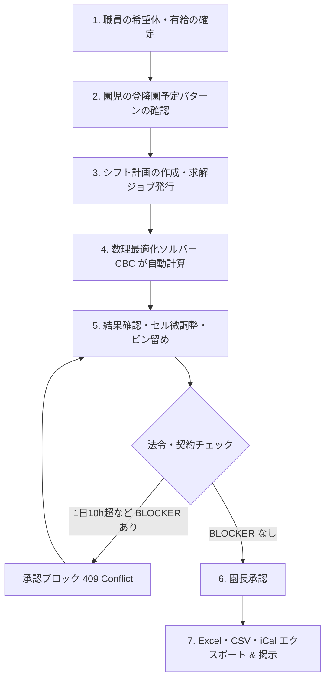

# 🧸 nusoft 総合操作・運用マニュアル (v0.4.0)

本書は、保育ICTプラットフォーム **nusoft (open-hoikuict v0.4.0)** の運用・操作マニュアルです。  
園長・施設長、主任保育士、一般保育士、事務職員、およびシステム管理者の皆様が、日々の業務で安全かつ円滑にシステムをご活用いただけるよう、実践的な手順を網羅しています。

---

## 目次

1. [はじめに & システム推奨環境](#1-はじめに--システム推奨環境)
   - 1.1 nusoft の思想
   - 1.2 推奨動作環境
2. [第1章: ログイン・セキュリティ・アカウント管理](#2-第1章-ログインセキュリティアカウント管理)
   - 2.1 ログイン手順と多要素認証 (MFA)
   - 2.2 パスワード変更とパスワード紛失時の復旧
   - 2.3 職員権限（ロール）の管理
3. [第2章: 初期設定と台帳管理](#3-第2章-初期設定と台帳管理)
   - 3.1 施設基本情報・開園時間・定員の設定
   - 3.2 クラス編成の登録
   - 3.3 園児・家庭台帳の登録（個別登録 & CSV一括取込）
   - 3.4 職員台帳・資格・有給休暇マスタ
4. [第3章: 日常保育業務](#4-第3章-日常保育業務)
   - 4.1 登降園キオスク（タッチ打刻）の運用
   - 4.2 保護者ポータルとの連携（出欠連絡・お迎え予定変更）
   - 4.3 デジタル連絡帳（記入・返信・承認）
   - 4.4 児童観察記録・保育要録（設定版楽観ロック）
   - 4.5 健康管理・身体測定・アレルギー把握
   - 4.6 お知らせ配信（Web Push通知・fail-closed配信）
   - 4.7 YouTube簡易動画配信（クラス別視聴制限・公開期限付き）
5. [第4章: 職員配置基準連動 シフト自動作成 (NuShift)](#5-第4章-職員配置基準連動-シフト自動作成-nushift)
   - 5.1 シフト作成の全体フロー（月次・週次）
   - 5.2 職員契約・希望休・有給休暇の入力と反映
   - 5.3 求解ジョブの実行（数理最適化ソルバー）
   - 5.4 シフト結果の確認（「実行可能解」と必要配置数）
   - 5.5 セル編集と「ピン留め (Pinning)」機能による再計算
   - 5.6 労働基準法違反 (BLOCKER) と園長承認ゲート
   - 5.7 急なお迎え変更と「リアルタイム配置割れギャップ警告」
   - 5.8 掲示用 Excel 勤務割表、CSV、iCal のエクスポート
6. [第5章: 請求管理・延長保育料・全銀Zengin口座振替](#6-第5章-請求管理延長保育料全銀zengin口座振替)
   - 6.1 登降園実績からの延長保育料自動算出
   - 6.2 請求一覧プレビューと手動調整
   - 6.3 全銀協標準フォーマット (Zengin) 口座振替データの出力
   - 6.4 振替結果の取り込みと消込処理
7. [第6章: システム管理・バックアップ・障害復旧](#7-第6章-システム管理バックアップ障害復旧)
   - 7.1 機微情報アクセス & シフト求解監査ログの確認
   - 7.2 データベースマイグレーション (Alembic) とスキーマ管理
   - 7.3 自動バックアップの仕組みと手動バックアップ
   - 7.4 バックアップからの復元（リストア）手順
   - 7.5 トラブルシューティング（緊急連絡先・一次切り分け）
8. [第7章: 保育公費加算・自治体監査対応・ICT補助金活用](#8-第7章-保育公費加算自治体監査対応ict補助金活用)
   - 8.1 人員配置加算と数理モデル連動
   - 8.2 自治体指導監査（実地検査）エビデンスの出力
   - 8.3 処遇改善等加算（Ⅰ・Ⅱ・Ⅲ）の労務管理連携
   - 8.4 保育所等ICT化推進補助金の採択要件
9. [管理者向け運用チェックリスト](#9-管理者向け運用チェックリスト)
   - 9.1 日次チェックリスト
   - 9.2 週次チェックリスト
   - 9.3 月次チェックリスト
10. [用語集](#10-用語集)
11. [トラブルシューティング詳細表](#11-トラブルシューティング詳細表)

---

## 1. はじめに & システム推奨環境

### 1.1 nusoft の思想

nusoft は、「園児と向き合うあたたかな保育の時間」を最大化するために設計されています。  
手書き書類や煩雑な計算、配置基準の複雑な確認作業をテクノロジーで自動化し、保育士の負担を劇的に軽減します。

### 1.2 推奨動作環境

| 端末区分 | 推奨環境 | 主な用途 |
| :--- | :--- | :--- |
| **事務用 PC** | Windows 10/11, macOS, Chrome / Edge 最新版 | 園長・主任・事務の管理業務、シフト作成、請求 |
| **保育室 タブレット** | iPad (iPadOS 16+), Android タブレット (10インチ以上) | 連絡帳入力、児童観察記録、園児出欠確認 |
| **玄関 キオスク端末** | Chromebook, iPad, Windows タブレット（固定設置） | 保護者・園児の登降園タッチ打刻 |
| **保護者 スマートフォン** | iPhone (iOS 15+), Android (Android 10+) | 保護者ポータル、連絡帳、出欠連絡、Web Push |

---

## 2. 第1章: ログイン・セキュリティ・アカウント管理

### 2.1 ログイン手順と多要素認証 (MFA)

nusoft では、園児の個人情報や職員の労務情報を保護するため、**多要素認証 (MFA - メールOTP)** を採用しています。

1. **ログイン画面へアクセス**: ブラウザで `https://<自園のドメイン>/login` を開きます。
2. **IDとパスワードの入力**: 登録済みのメールアドレスとパスワードを入力し、「ログイン」をクリックします。
3. **認証コードの受信**: 登録メールアドレス宛に「【nusoft】ログイン認証コードのお知らせ」というメールが届きます（6桁の数字）。
4. **コード入力**: 画面に表示された入力枠に6桁の数字を入力し、「認証」をクリックします（有効期限は10分間です）。

> [!NOTE]
> 専用のAuthenticatorアプリ（Google Authenticator等）のインストールは不要です。スマートフォンやPCのメールさえ受信できれば、どなたでも簡単に安全なログインが可能です。

**画面イメージ**: ログイン画面（メールアドレス・パスワード入力欄、6桁認証コード入力欄）

### 2.2 パスワード変更と復旧

- **パスワード変更**: 画面右上の職員名をクリック ＞「マイアカウント設定」＞「パスワード変更」から行います。
- **パスワードを忘れた場合**: ログイン画面の「パスワードをお忘れの方はこちら」をクリックし、登録メールアドレスを入力します。パスワード再設定用の一時URLがメールで届きます。

### 2.3 職員権限（ロール）の管理

職員ごとに適切な権限を設定することで、誤操作や情報の過剰閲覧を防止します。

| ロール | 主な権限 |
| :--- | :--- |
| **園長 (Admin)** | 全機能の利用、シフトの最終承認、施設設定、バックアップ、監査ログの閲覧。 |
| **主任 (Chief)** | 児童記録、連絡帳承認、シフト計画の作成・求解・編集、お知らせ配信。 |
| **一般保育士 (Staff)** | クラス園児の出欠確認、連絡帳記入、観察記録作成、自身のシフト確認・希望休申請。 |
| **事務・経理 (Accountant)** | 延長保育料集計、請求管理、全銀口座振替データ出力。 |

**画面イメージ**: 職員権限設定画面（ロール選択プルダウン、権限一覧テーブル）

---

## 3. 第2章: 初期設定と台帳管理

### 3.1 施設基本情報・開園時間・定員の設定

メニュー「施設設定」＞「基本情報」を開きます。

1. **基本情報**: 施設名、郵便番号、住所、電話番号、認可区分を設定します。
2. **開園時間**:
   - 開園時刻（例: 07:00）および 閉園時刻（例: 20:00）
   - 保育標準時間枠（例: 07:30 〜 18:30）
   - 保育短時間枠（例: 08:30 〜 16:30）
3. **休園日**: 日曜日、祝日、年末年始（12/29〜1/3）など定期休園日を指定します。

**画面イメージ**: 施設基本情報設定画面（入力フォーム、時間ピッカー）

### 3.2 クラス編成の登録

メニュー「クラス管理」から、年度ごとのクラスを登録します。

- **年齢区分**: 0歳児、1歳児、2歳児、3歳児、4歳児、5歳児
- **クラス名**: （例: ひよこ組、りす組、うさぎ組、きりん組、ぞう組）
- **定員および担当保育士**: 主担任・副担任を割り当てます。

### 3.3 園児・家庭台帳の登録

「園児台帳」メニューより、新規登録または一括CSV取込が可能です。

- **個別登録**: 氏名、生年月日、クラス、認定区分（1号・2号・3号）、標準/短時間の別、緊急連絡先、アレルギー情報を入力します。
- **一括CSVインポート**:
  1. 「CSVテンプレートをダウンロード」をクリックします。
  2. Excel 等で園児・保護者情報を入力し、CSV（UTF-8）形式で保存します。
  3. 「CSVファイルをアップロード」をクリックすると、プレビュー確認画面を経て一括登録されます。
- **保護者の招待**: 登録後、保護者のメールアドレス宛に招待メールを送信します。保護者がパスワードを設定すると、保護者ポータルが利用可能になります。

### 3.4 職員台帳・資格・有給休暇マスタ

「職員管理」メニューより、職員の基本契約と資格情報を登録します。

- **保有資格**: 保育士、看護師、子育て支援員、幼稚園教諭などの資格をチェックします（※配置基準ソルバーの計算対象判定に使用されます）。
- **雇用形態**: 常勤（フルタイム）、非常勤（パート・固定時間、シフト枠指定）。
- **有給休暇台帳**: 年次有給休暇の付与日数、残日数を管理します。有給休暇の申請・承認は、後述のシフト自動作成エンジンに自動連動します。

---

## 4. 第3章: 日常保育業務

### 4.1 登降園キオスク（タッチ打刻）の運用

園の玄関に設置したキオスク端末（タブレット・Chromebook等）で運用します。

1. **画面表示**: キオスクモードで画面を開きます（全画面表示推奨）。
2. **打刻方法**:
   - クラスを選択し、園児の顔写真または氏名カードをタップします。
   - 「登園」または「降園」ボタンをタップすると、打刻音が鳴り完了します。
   - お迎えに来られた方（父・母・祖父母等）を選択できます。

**画面イメージ**: キオスク打刻画面（クラス選択、園児カード一覧、登園/降園ボタン）

### 4.2 保護者ポータルとの連携

保護者のスマートフォンから以下の連絡がリアルタイムに園に届きます：

- **欠席・遅刻・早退連絡**: 当日の理由と予定時刻の送信。
- **お迎え時間変更・代理お迎え**: 「予定より30分遅れる」「祖母がお迎えに行く」などの連絡。

### 4.3 デジタル連絡帳（記入・返信・承認）

1. **記入**: 保育士はクラス一覧から園児を選択し、園での様子、昼食の喫食量、お昼寝時間、排泄状況を入力します。
2. **主任・園長確認**: 提出された連絡帳は「未承認一覧」に集約されます。内容を確認し、ワンクリックで承認すると保護者ポータルへ公開されます。
3. **保護者からのコメント**: 保護者が記入した家庭での様子（朝の体温、昨晩の睡眠、連絡事項）は、出欠ボードから一覧で確認できます。

### 4.4 児童観察記録・保育要録（設定版楽観ロック）

日常のエピソード記述や、発達のチェック項目を記録します。
- **独自項目UUID**: 園の保育方針に合わせたオリジナルの観察指標（「言葉の発達」「基本的生活習慣」等）を自由に追加できます。
- **同時編集保護**: 複数担任が同時に記録を開いた場合、設定版楽観ロック (`lock_version`) により古い情報での意図しない上書きを防止します。

### 4.5 健康管理・身体測定・アレルギー把握

- **身体測定**: 毎月の身長・体重を入力すると、乳幼児発育曲線グラフに自動プロットされます。
- **アレルギー管理**: 除去品目や緊急時対応マニュアル（エピペン有無など）を顔写真付きで即座に参照できます。

### 4.6 お知らせ配信（Web Push通知・fail-closed配信）

園だよりや緊急連絡（台風による休園、不審者情報など）を配信します。
- **対象選択**: 全体、クラス指定、個別指定が可能。
- **fail-closed設計**: 入力に誤りがある場合は全園児へ誤配信されることを防ぎ、安全側に倒して配信を停止します。
- **Web Push**: 保護者のスマートフォンの画面にプッシュ通知がポップアップします。

### 4.7 YouTube簡易動画配信（クラス別視聴制限・公開期限付き）

運動会、お遊戯会、生活発表会、日頃の保育参観などの動画を、保護者ポータルへ安全に配信できます。

1. **YouTubeへの動画アップロード（事前準備）**:
   - 園のYouTubeアカウントに動画をアップロードし、公開設定を **「限定公開（リンクを知っている人のみ閲覧可能）」** に設定します。
2. **動画の新規登録（職員メニュー「動画配信管理」）**:
   - **YouTube URL**: YouTubeの共有URL（`https://youtu.be/...` や `https://www.youtube.com/watch?v=...`）または動画IDを貼り付けます。
   - **タイトル自動取得（oEmbed連携）**: URL貼り付け後に右横の **「🔍 タイトル自動取得」** ボタンをクリックすると、YouTube APIキー不要でYouTube公式oEmbedサービスから動画タイトルやサムネイル情報を自動取得してタイトル欄に補完します。
   - **説明文（任意）**: 保護者への見どころやメッセージを入力。
   - **配信対象**:
     - **全体（全学年）**: 園全体のイベント動画など、保護者全員が視聴できます。
     - **クラス限定**: 指定したクラス（例: 「ひよこ組」）に在籍する園児の保護者のみに視聴を制限します。
   - **公開期間（公開日時・公開期限）**: 公開期限（終了日時）を設定すると、期限到来後に保護者ポータルから自動的に非公開となり再生できなくなります。
   - **ステータス**: 「下書き」または「公開」。下書き中は職員のみプレビュー可能で、保護者には表示されません。
3. **動画一覧・ページネーション管理**:
   - 登録数が増えた場合も1ページ12件ごとのスムーズなページ送り機能（ページネーション）により、快適に過去動画を閲覧・管理できます。
4. **保護者ポータルでの安全な視聴 & PWAキャッシュ**:
   - 保護者画面のメニュー「動画配信」またはホームバナーから動画一覧を開きます。
   - Cookieを使用しない安全な埋め込みドメイン（`youtube-nocookie.com`）を採用し、保護者のプライバシーを保護。
   - 画面上には「園児のプライバシー保護のため、SNSへの無断転載・動画の保存や再配布はお控えください」とのガイダンスを明記しています。

---

## 5. 第4章: 職員配置基準連動 シフト自動作成 (NuShift)

nusoft の最大の特徴である、**法令配置基準連動 数理最適化シフト自動作成エンジン (NuShift)** の操作手順です。

### 5.1 シフト作成の全体フロー

**画面イメージ**: シフト作成ウィザード画面（ステップ進捗バー、入力フォーム）

### 5.2 職員契約・希望休・有給休暇の入力と反映

1. メニュー「シフト管理」＞「職員条件設定」を開きます。
2. 職員ごとに以下の条件を確認・設定します：
   - 週間契約時間、1日最大労働時間（例: 8時間）
   - 月間希望休（「この日は休みたい」日程）
   - 承認済み有給休暇（有給管理モジュールから自動反映されます）
   - 連続勤務日数上限（通常5日または6日）

### 5.3 求解ジョブの実行（数理最適化ソルバー）

1. 「シフト計画作成」をクリックし、対象週（7日間）を選択します。
2. 配置基準を選択します（例: `全国基準（厚労省）`、`東京都基準`、`福岡市基準` 等）。
3. 「最適化を実行」ボタンをクリックします。
4. バックグラウンドで CBC ソルバーが数理モデル（MILP）を解析します（通常10〜30秒）。画面には進捗状況が表示されます。

**画面イメージ**: 求解実行画面（進捗バー、ソルバー選択、配置基準プルダウン）

### 5.4 シフト結果の確認（「実行可能解」と必要配置数）

最適化が完了すると、シフトマトリクスが表示されます。
- **実行可能解 (Feasible)**: 厚労省配置基準、各職員の契約上限、希望休がすべて満たされた安全なシフトです。
- **時間帯別必要人数バー**: 各15分/30分コマごとに「必要保育士数」と「実配置数」がグラフ表示され、余剰やギリギリのコマが一目でわかります。

**画面イメージ**: シフトマトリクス表示画面（ガントチャート、必要人数バー）

### 5.5 セル編集と「ピン留め (Pinning)」機能による再計算

現場の個別事情（「この日は研修があるので◯◯先生を固定したい」「行事準備のためリーダーを早番にしたい」など）に合わせて、手動でセルを調整できます。

1. 変更したいセルをクリックし、シフト枠（早番、中番、遅番、休み等）を変更します。
2. **ピン留めアイコン（📌）をクリック**: セルが「ピン留め固定」状態になります。
3. **再計算の実行**: 再び「最適化を実行」を押すと、**ピン留めされたセルはそのまま維持され**、それ以外の未固定セルのみが法令基準を満たすよう自動で再調整されます。

**画面イメージ**: セル編集画面（シフト枠プルダウン、ピン留めアイコン📌）

### 5.6 労働基準法違反 (BLOCKER) と園長承認ゲート

nusoft は保育士の健康と労働コンプライアンスを保護するため、厳格な承認ゲートを備えています。

- **BLOCKER 違反**:
  - 労働基準法第32条違反（1日10時間を超える勤務）
  - 保育士配置基準割れ（必要人数を下回るコマが存在する）
- **承認ゲート**:
  - BLOCKER が1件でも残っている場合、園長承認ボタンは無効化され、承認を実行しようとしても `409 Conflict` でシステムが遮断します。
  - 要調整（WARNING: 連続勤務日数の超過、休憩不足等）がある場合は、内容を確認の上で園長判断による承認が可能です。

### 5.7 急なお迎え変更と「リアルタイム配置割れギャップ警告」

保護者が夕方のお迎え予定を延長した場合、バックエンドの `gap_analysis` エンジンが即座に連動します。
- **配置割れ警告バナー**: シフト画面上部に赤色のバナーが表示され、「17:30〜18:00 に保育士が1名不足しています」と具体的なギャップを提示します。
- 現場は直ちにパート職員の延長要請や応援配置を行い、基準違反を未然に防ぐことができます。

### 5.8 掲示用 Excel 勤務割表、CSV、iCal のエクスポート

承認が完了したシフトは、ワンクリックで各種形式に出力できます：
- **Excel 勤務割表 (.xlsx)**: 職員室の壁にそのまま貼り出せる、A3/A4対応の美しいレイアウト。資格種別・日別勤務時間・免責文言付き。
- **BOM付き CSV (.csv)**: 給料計算ソフト（弥生給与、マネーフォワード等）へ取り込める形式。Excelで開いても文字化けしません。
- **iCalendar (.ics)**: Google カレンダーや iPhone カレンダーへ一括取り込みできるスケジュールファイル。

---

## 6. 第5章: 請求管理・延長保育料・全銀Zengin口座振替

### 6.1 登降園実績からの延長保育料自動算出

毎月末の締め日に、「請求管理」＞「延長保育料集計」を開きます。
- 登降園キオスクの打刻実績に基づき、各園児の「標準時間外」「短時間外」の利用実績を15分/30分単位で自動集計します。
- 月極契約の園児には定額料金を、スポット利用の園児には回数/時間に応じた従量料金を自動適用します。

### 6.2 請求一覧プレビューと手動調整

- 集計結果が一覧表示され、園児ごとに明細（基本保育料、給食費、延長保育料、教材費等）を確認できます。
- 事情による割引や臨時費用の追加がある場合、画面上から明細の修正が可能です。

### 6.3 全銀協標準フォーマット (Zengin) 口座振替データの出力

1. 「全銀データ生成」をクリックします。
2. 委託者コード、振替指定日（例: 翌月10日）を確認します。
3. **データ出力**: 全銀協規定に完全準拠した固定長テキストファイル（全銀フォーマット）がダウンロードされます。
4. **ネットバンキングへの取込**: 各金融機関（みずほ、三菱UFJ、三井住友、ゆうちょ、地方銀行、信用金庫等）のビジネスWebバンキングの「口座振替データ伝送」メニューから、出力ファイルをそのままアップロードします。

### 6.4 振替結果の取り込みと消込処理

後日、金融機関からダウンロードした「振替結果ファイル」を nusoft にアップロードすることで、入金消込が自動完了します。振替不能（残高不足等）の園児は一覧で赤色表示され、再請求や現金回収の管理が容易に行えます。

---

## 7. 第6章: システム管理・バックアップ・障害復旧

### 7.1 機微情報アクセス & シフト求解監査ログの確認

システム管理者メニュー「監査ログ」から、以下のセキュリティイベントを検索・閲覧できます：
- ログイン成功/失敗、MFAコード検証
- 園児・保護者の個人情報閲覧およびエクスポート履歴
- 口座番号などの金融情報の変更履歴
- シフトの承認・改ざん防止ログ、およびシフト求解ジョブを発行した職員ユーザーID・パラメータ・実行結果の追跡記録

**画面イメージ**: 監査ログ画面（イベント種別フィルタ、日時範囲、ログ一覧テーブル）

### 7.2 データベースマイグレーション (Alembic) とスキーマ管理

nusoft は安全かつ再現性の高いデータベース構造更新のため、標準マイグレーションツール **Alembic** を導入しています。
- **バッチモード対応**: SQLite の制約（ALTER TABLE 制約）を考慮したバッチ移行モードを採用しており、運用中データの欠損なく安全にカラム追加・インデックス作成が可能です。
- **更新手順**: 新バージョンへのアップデート時、ターミナルで `alembic upgrade head` を実行するだけで最新スキーマへ自動同期されます。

### 7.3 自動バックアップの仕組みと手動バックアップ

- **自動日次バックアップ**: 毎日深夜に自動的にデータベースのスナップショットが作成され、世代管理されます。
- **整合性検証 (Backup Contract)**: スキーマ契約ファイルと突合し、破損や欠損のない完全なバックアップであることを自動検証します。
- **手動バックアップ**: バージョンアップ作業前や月次締め処理前には、「システム設定」＞「バックアップ作成」から即座に手動保存が可能です。

### 7.4 バックアップからの復元（リストア）手順

万が一のサーバー障害やデータ誤削除に備え、メンテナンスモード制御下でのアトミック復元が可能です。
1. 「メンテナンスモード」を有効化し、一般ユーザーのアクセスを一時停止します。
2. 復元対象のバックアップ世代を選択します。
3. 「復元を実行」をクリックします。整合性チェックを経て安全にリストアされ、完了後にメンテナンスモードが自動解除されます。

### 7.5 トラブルシューティング（緊急連絡先・一次切り分け）

| 症状 | 考えられる原因 | 対処方法 |
| :--- | :--- | :--- |
| **MFAメールが届かない** | 迷惑メールフォルダへの振分け、アドレス誤登録 | 迷惑メールを確認。管理者に連絡し、職員台帳のメールアドレス設定を確認・再送。 |
| **シフト作成でエラーが出る** | 職員数が不足している、条件が厳しすぎる | 園児数に対して出勤可能な保育士数が絶対的に不足していないか確認。制約条件を緩和して再計算。 |
| **シフト承認ボタンが押せない** | BLOCKER 違反（1日10h超など）が残っている | 違反一覧を確認し、該当セルの勤務時間を調整するか、ピン留めを外して再計算。 |
| **全銀データのアップロードで銀行エラー** | 委託者コードや支店番号の不一致 | 施設設定の銀行情報・口座番号の桁数（7桁ゼロ埋め等）を再確認して再出力。 |
| **画面表示が崩れる/古い表示のまま** | ブラウザキャッシュの残存 | Ctrl + F5 (Windows) または Shift + Command + R (Mac) でキャッシュクリアして再読み込み。 |
| **キオスク端末で打刻できない** | ネットワーク不通、ブラウザ互換性 | 端末のWi-Fi接続を確認。Chrome/Edge最新版を使用し、キオスクモード（全画面）に設定。 |
| **Web Push通知が届かない** | 通知許可未設定、Service Worker未登録 | 保護者側でブラウザ通知を「許可」に設定。サイトを再訪問して通知許可ダイアログを再表示。 |

---

## 8. 第7章: 保育公費加算・自治体監査対応・ICT補助金活用

保育園・こども園の安定的経営と適正な運営を支えるため、本システムを活用した公費加算の算定・自治体指導監査（実地検査）への対応手順を解説します。

### 8.1 人員配置加算と数理モデル連動

自治体や国の公費加算（施設型給付費）には、手厚い保育士配置を条件とする加算が多数存在します。
- **3歳児配置改善加算（15:1） / チーム保育推進加算**:
  - メニュー「シフト管理」＞「配置ルール設定」で適用基準（例: `東京都基準`、`福岡市基準`、`手厚い15:1モデル`）を選択します。
  - 数理最適化ソルバー（NuShift）が、開所時間（7:00〜20:00等）全コマにわたって指定比率および最低2名配置ルールを厳密に満たすシフトを算出します。
- **延長保育加算**:
  - キオスク打刻実績から延長保育時間帯の在園児数を正確に抽出し、延長枠における必要保育士数をリアルタイム突合。夕方の突発的なお迎え延長による配置割れを防ぎます。

### 8.2 自治体指導監査（実地検査）エビデンスの出力

自治体の定期監査では、加算要件を満たしていたか過去の勤務実績・登降園記録の提出が求められます。
- **勤務割実績表のエクスポート**:
  - メニュー「シフト管理」＞「エクスポート」から、承認済み実績勤務割表（Excel / BOM付きCSV）を出力します。
  - 各職員の資格区分（保育士・看護師・支援員）、日別・時間帯別勤務時間、免責文言が記載されており、監査提出書類としてそのまま利用可能です。
- **監査ログの保管**:
  - 「誰が、いつ、どのシフトを承認したか」「打刻時刻を修正した理由は何か」が機微情報監査ログに自動保管されているため、記録の改ざん疑義を完全に排除できます。
- **加算返還リスクの防止**:
  - BLOCKER承認ゲートにより「配置割れがあるシフト表の承認」自体が物理的に遮断されているため、監査時に遡及返還（数百万円〜数千万円の返還命令）を命じられるリスクを根本から防止します。

### 8.3 処遇改善等加算（Ⅰ・Ⅱ・Ⅲ）の労務管理連携

- **処遇改善等加算Ⅱ（専門リーダー・職務分野別リーダー等）**:
  - 職員台帳に「修了研修分野（乳児保育、食育・アレルギー等）」「任命役職」を記録・管理。
- **処遇改善等加算Ⅰ・労働基準法遵守**:
  - 年次有給休暇取得義務（年5日）の取得状況台帳とシフト希望休の自動同期。
  - 労働基準法第32条（1日10時間超の過密勤務）の事前検知により、健全な職場環境づくりと労務監査適合を支援します。

### 8.4 保育所等ICT化推進補助金の採択要件

本システムは、こども家庭庁および各自治体が実施する「保育所等におけるICT化推進事業（補助金）」の対象要件を満たすよう設計されています。
- **対象要件網羅**: 登降園管理（タッチ打刻）、保護者ポータル（連絡帳・お知らせ）、指導計画・児童観察記録、請求管理の4領域を完全カバー。
- **費用対効果**: 商用パッケージとして園の規模や運用形態に応じた明瞭かつ低廉な料金体系を採用しており、ICT補助金を活用した初期導入・端末環境拡充にも柔軟に対応します。

---

## 9. 管理者向け運用チェックリスト

システムを安定的に運用するため、以下のチェックリストを日次・週次・月次で実施してください。

### 9.1 日次チェックリスト

- [ ] 登降園キオスク端末の電源・ネットワーク接続を確認
- [ ] 当日の未承認連絡帳を全クラス分確認・承認
- [ ] Web Push 通知の送信状況を確認（緊急連絡の有無）
- [ ] シフト画面の「配置割れ警告バナー」を確認、不足があれば応援配置を検討
- [ ] 監査ログに異常なログイン失敗や機密情報アクセスがないか確認
- [ ] 自動バックアップが正常に完了したか確認（管理画面またはログ）

### 9.2 週次チェックリスト

- [ ] 翌週のシフト計画を作成・求解し、BLOCKER違反がないか確認
- [ ] 園長によるシフト最終承認を実行
- [ ] 職員の有給休暇・希望休申請を承認・反映
- [ ] 延長保育料の週次集計をプレビュー確認
- [ ] パート・非常勤職員の勤務時間が契約上限を超えていないか確認

### 9.3 月次チェックリスト

- [ ] 月末の延長保育料集計を確定し、請求明細を園児ごとに確認
- [ ] 全銀Zengin口座振替データを生成・ネットバンキングで伝送
- [] 金融機関からの振替結果ファイルを取り込み、消込処理を完了
- [ ] 月次バックアップを手動作成し、整合性を検証
- [ ] 監査ログを月次でエクスポート・保管（監査対応エビデンス）
- [ ] システムバージョンの確認・必要に応じてアップデート計画を策定
- [ ] 処遇改善等加算・ICT補助金に関する実績データを出力・整理

---

## 10. 用語集

| 用語 | 意味 |
| :--- | :--- |
| **MFA** | 多要素認証。パスワードに加え、メール送信の6桁OTPコードで本人確認を行う仕組み。 |
| **CSP Nonce** | Content-Security-Policy の一時値。リクエスト毎に生成され、インラインスクリプト悪用によるXSSを防ぐ。 |
| **BLOCKER 承認ゲート** | 法令違反（1日10h超勤務や配置基準割れ）があるシフト表の承認をHTTP 409で自動遮断する仕組み。 |
| **ピン留め (Pinning)** | シフトセルを固定し、再計算時にもその配置を保護する機能。 |
| **実行可能解 (Feasible)** | すべてのハード制約（法令・契約・希望休等）を満たすシフト解。数学的最適性の証明は不要。 |
| **ウォームスタート** | 貪欲法による暫定解をソルバーに事前投入し、求解時間を短縮する手法。 |
| **gap_analysis** | 保育士配置数と必要配置数の過不足（ギャップ）をリアルタイムに検知するエンジン。 |
| **全銀フォーマット (Zengin)** | 全銀協規定の口座振替データ標準フォーマット（固定長テキスト）。 |
| **消込 (しこみ)** | 振替結果と請求データを照合し、入金・未収を確定させる処理。 |
| **楽観ロック (lock_version)** | 同時編集時の上書き事故を防ぐため、更新時にバージョン番号を比較する制御。 |
| **PWA** | Progressive Web App。Service Workerによるキャッシュでオフライン耐性・高速表示を実現するWebアプリ。 |
| **Alembic** | データベーススキーママイグレーションツール。テーブル変更をバージョン管理して安全に適用。 |
| **StorageDriver** | ファイル保存を抽象化したレイヤー。ローカル保存と将来のS3移行を切り替え可能。 |
| **処遇改善等加算** | 保育士の処遇改善を目的とした国の加算制度（Ⅰ・Ⅱ・Ⅲ）。 |
| **配置改善加算** | 保育士配置基準を満たすことで算定できる保育所等の公費加算。 |

---

## 11. トラブルシューティング詳細表

| エラーコード / 症状 | 原因 | 対処法 | 関連ドキュメント |
| :--- | :--- | :--- | :--- |
| **409 Conflict** (シフト承認) | BLOCKER違反（1日10h超・配置基準割れ） | 違反セルを修正するかピン留めを外して再計算し、再度承認 | MANUAL.md 5.6 |
| **MFAメール未着** | 迷惑メール振り分け・アドレス誤登録・SPF/DKIM遮断 | 迷惑メール確認、アドレス修正、管理者によるMFA一時リセット | Q_AND_A.md Q7-1 |
| **シフト求解タイムアウト** | 制約が厳しすぎる、職員数不足 | 制約を緩和、希望休を見直し、ソルバー時間制限を延長 | Q_AND_A.md Q2-1 |
| **全銀フォーマットエラー** | 委託者コード/支店番号/口座番号の桁数不正 | 施設設定の銀行情報を確認し7桁ゼロ埋め等で再出力 | Q_AND_A.md Q6-2 |
| **打刻反映されない** | ネットワーク不通・ブラウザキャッシュ | 端末接続確認、Ctrl+F5でキャッシュクリア | MANUAL.md 7.5 |
| **Web Push未送信** | 通知許可未設定・Service Workerエラー | ブラウザ通知を許可、サイト再訪問で許可ダイアログ表示 | Q_AND_A.md Q5-3 |
| **CSV文字化け** | 文字コード不一致（UTF-8 vs Shift_JIS） | CSVをUTF-8（BOM付き）で保存し再インポート | MANUAL.md 3.3 |
| **楽観ロック競合エラー** | 他職員が先に保存済み | 最新内容を再読込し、改めて編集・保存 | Q_AND_A.md Q5-1 |
| **YouTube動画未取得** | URL形式不正・動画非公開 | youtu.be/watch?v= 形式の共有URLを使用、限定公開設定を確認 | Q_AND_A.md Q5-4 |
| **バックアップ失敗** | ディスク容量不足・DBロック | ディスク空き容量を確保、バックアップ時間を深夜帯にずらす | MANUAL.md 7.3 |

---

*本書の内容は nusoft v0.4.0 に基づいています。機能追加や仕様改善により、一部画面表記が更新される場合があります。*
