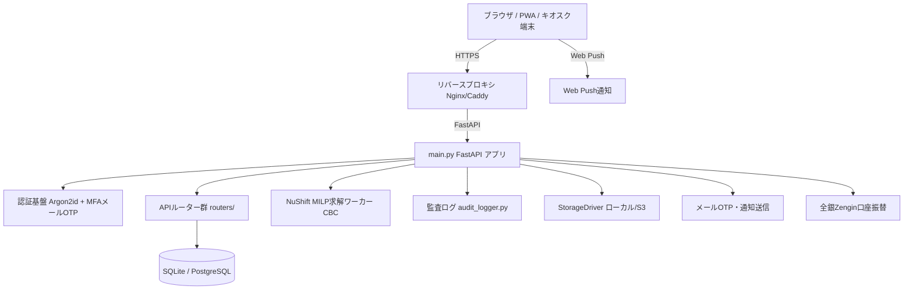

# 🧸 nusoft (open-hoikuict v0.4.0)

> **保育のすべてをつなぎ、先生の時間をこどもたちへ**  
> 職員配置基準連動型 数理最適化シフト自動作成エンジン（NuShift）と、保育園・こども園の日常業務をワンストップで支える次世代保育総合ICTソリューション。

[](version.py)
[](pyproject.toml)
[](LICENSE)
[](pyproject.toml)
[](security_config.py)
[](.github/)
[](SUPPORT.md)
[](https://github.com/hoikuict/open-hoikuict/discussions)
[](SECURITY.md)

**[デモ環境](https://demo.hoikuict.net/) | [本番環境](https://open.hoikuict.net/) | [操作マニュアル](MANUAL.md) | [Q&A (よくある質問)](Q_AND_A.md) | [ランディングページ](landing_page/index.html) | [技術ガイド](docs/technical-guide.md) | [セキュリティポリシー](SECURITY.md) | [コントリビューション](CONTRIBUTING.md)**

---

## 1. nusoft とは

**nusoft** は、保育総合ICTシステム `open-hoikuict` を中核とし、職員配置基準連動型 数理最適化ソルバー **NuShift (shiftai)**、多要素認証 (MFA)、全銀Zenginフォーマット請求連携、および堅牢なエンタープライズ・セキュリティ基盤を完全統合した商用保育ICTプラットフォーム（個人プロジェクト商用版・全権利保持）です。

### 主な特長

1. **🧸 保育業務のワンストップ統合**
   - 園児・保護者台帳、登降園キオスク（タッチ打刻）、体温・機嫌・食事等の日次連絡帳、独自項目UUID対応の児童観察記録・指導要録、アレルギー・身体測定を含む健康管理、Web Push通知まで全業務を網羅。
2. **⚡ 日本初・法令配置基準連動 シフト自動作成 (NuShift Core)**
   - 厚生労働省告示第49号（全国基準）および各自治体の独自基準（東京都、福岡市など）に完全対応。
   - 混合整数線形計画法（MILP / CBCソルバー）により、週7日間の勤務割を数秒〜数十秒で自動作成。
   - 現場の微調整を保護する「セル編集・ピン留め（Pinning）」機能、労働基準法第32条（1日10h超）違反や配置不足を自動検出して承認をブロックする「BLOCKER 承認ゲート」、急なお迎え予定変更にリアルタイム連動する「配置割れギャップ検知」を搭載。
   - 求解ジョブはDB永続キュー（`solve_jobs`）駆動型非同期ワーカーにより、サーバー再起動耐性と実行者ID記録・構造化監査ログを完備。
3. **🎥 YouTube限定公開動画ストリーミング（保護者ポータル連携）**
   - 運動会やお遊戯会の動画を、YouTube限定公開と `youtube-nocookie.com` を用いてセキュアに配信。
   - クラス別視聴制限、公開期限の自動制御、YouTube oEmbed APIによるタイトル・サムネイル自動取得、快適なページネーションに対応。
4. **💰 延長保育料自動計算 & 全銀Zengin口座振替**
   - 登降園実績に基づく延長料金の自動算出。
   - 全銀協標準フォーマット（Zengin）準拠の口座振替データを1クリックで生成し、金融機関とのスムーズな振替連携を実現。
5. **🔒 金融・医療水準のゼロトラストセキュリティ & 運用基盤**
   - メールOTPによる多要素認証 (MFA) 標準対応（TOTP専用アプリ不要）。
   - リクエスト毎に動的生成される CSP (Content-Security-Policy) Nonce、Chart.js・Tailwind・HTMX ローカルバンドルによる完全オフライン＆CDN脱却。
   - レートリミット（IP偽装防止・メモリ自動クリーンアップ機能付き）。
   - 児童・保護者・職員の機微情報アクセスおよびシフト求解要求を漏れなく追跡する監査ログ基盤。
   - Alembic による安全なスキーママイグレーションと、将来の S3/クラウド移行を見据えた `StorageDriver` 抽象化レイヤー。
   - PWA Service Worker の静的アセット事前キャッシュによるオフライン耐性と高速表示。
6. **🏛️ 保育公費加算・自治体監査対応 & ICT補助金適合**
   - **加算算定と返還リスク防止**: 3歳児配置改善加算（15:1）やチーム保育推進加算、延長保育加算などの要件を確実に満たすシフトを数理モデルで担保。自治体実地検査（指導監査）での「配置割れによる加算返還命令」を物理的に遮断。
   - **処遇改善等加算（Ⅰ・Ⅱ・Ⅲ）エビデンス**: 保有資格・職務分野別リーダー研修受講歴・年次有給休暇取得状況（年5日義務）の一元管理と勤務割実績の自動出力。
   - **保育所等ICT化推進補助金要件適合**: 登降園・連絡帳・計画記録・請求の全領域をカバーし、自治体補助金の採択基準に準拠。低コストな商用提供により、園の導入負担を抑えながら職員・園児還元を最大化。

---

## 2. システム構成とバージョン情報 (v0.4.0)

本リポジトリは **v0.4.0** として、全てのフェーズ（Phase 0〜3）の負債解消と最新機能統合が完了しています。

| 指標 | 実績値 | 備考 |
| :--- | :--- | :--- |
| **Python ファイル数** | 318 本 | vendor, venv, gen_bunnrei を除く |
| **Python 総コード行数** | 約 86,500 行 | 型アノテーション・Ruff準拠 |
| **データモデル (`models.py`)** | 176 クラス / 2,750 行 | SQLModel / SQLite & PostgreSQL 両対応 |
| **マイグレーション** | Alembic (Batch mode) | SQLite/Postgres 互換マイグレーション完備 |
| **ストレージ基盤** | `StorageDriver` 抽象化 | ローカル保存 / 将来の S3 オブジェクトストレージ対応 |
| **APIルーター (`routers/`)** | 39 ファイル (全46ルーター) | FastAPI 構成 (動画配信・oEmbedプレビュー含む) |
| **テストスイート** | 100 ファイル以上 | pytest / 回帰防止テスト完備 |
| **シフトソルバー統合** | `vendor/nushift/shiftai` | CBCソルバー DB駆動非同期ワーカー・監査連動 |

### アーキテクチャ概要図



### ディレクトリ構成

```text
open-hoikuict/
├── alembic/                # Alembic データベーススキーママイグレーション環境
├── child_records/          # 児童観察記録・要録・成長進捗管理 (独自項目UUID対応)
├── common/                 # 共通楽観ロック (optimistic_lock.py) など基盤モジュール
├── data/                   # 規定データ・初期マスタ
├── docs/                   # 仕様書・運用設計書・導入ガイド・技術ドキュメント
├── landing_page/           # モダンで美しいプロダクト紹介LP (HTML/CSS/JS)
├── plan_docs/              # 指導計画・月案・文例ライブラリ
├── routers/                # FastAPI ルーター群 (登降園、請求、MFA、職員、児童、動画配信など)
├── shift_schedule/         # 職員シフト自動作成 UI・API・求解ワーカー・ギャップ検知
│   ├── routers/            # シフト計画、セル編集、エクスポート、施設設定
│   └── services/           # solve_jobs (DB駆動CBC非同期ワーカー), gap_analysis
├── static/                 # 静的アセット (CSS, JS, アイコン, ローカルChart.js/Tailwind/HTMX)
├── templates/              # Jinja2 HTML テンプレート群 (CSP Nonce 準拠)
├── tests/                  # 単体・結合・セキュリティ回帰テストスイート
├── vendor/nushift/shiftai/ # NuShift ソルバーコア (MILP / 配置基準最適化エンジン)
├── alembic.ini             # Alembic マイグレーション設定ファイル
├── auth.py / local_auth.py # 認証基盤 (Argon2id, セッション管理)
├── audit_logger.py         # 機微情報アクセス・シフト求解監査ログ
├── database.py             # データベース接続・マイグレーション・テーブル初期化
├── main.py                 # FastAPI アプリケーションエントリーポイント
├── MANUAL.md               # 包括的ユーザー・運用操作マニュアル
├── pyproject.toml          # プロジェクト設定・Ruff・pytest 設定
├── Q_AND_A.md              # 保育現場・管理者向け総合 Q&A / FAQ
├── rate_limiter.py         # レート制限 (メモリ掃除・IP偽装対策)
├── requirements.txt        # 本番実行依存関係 (FastAPI, PuLP, Pandas 等)
├── security_config.py      # セキュリティ設定・環境バリデーション
├── security_headers.py     # セキュリティHTTPレスポンスヘッダー (動的 CSP Nonce 対応)
├── storage_driver.py       # ストレージ抽象化レイヤー (Local / S3)
├── version.py              # バージョン定義 (v0.4.0)
├── youtube_utils.py        # YouTube 動画ID解析 & oEmbed メタデータ自動取得
├── zengin_service.py       # 全銀協標準フォーマット口座振替サービス
└── LICENSE                 # 商用プロプライエタリ ライセンス
```

---

## 3. クイックスタート

### 3.1 動作要件

| 項目 | 要件 | 備考 |
| :--- | :--- | :--- |
| **OS** | Windows 11 / 10, Ubuntu 22.04 LTS / 24.04 LTS, macOS, TrueNAS SCALE | 開発・本番両対応 |
| **Python** | 3.11 または 3.12 | 公式サポート |
| **メモリ** | 4 GB 以上推奨 | ソルバー実行時は 8 GB 推奨 |
| **ディスク空き容量** | 5 GB 以上 | データベース・バックアップ・ログを含む |
| **ソルバー** | COIN-OR CBC ソルバー (PuLP 経由で同梱、またはシステムインストール) | MILP 最適化用 |
| **データベース** | SQLite (開発/小規模) / PostgreSQL (本番/中規模以上) | Alembic マイグレーション対応 |
| **ブラウザ** | Chrome / Edge / Safari 最新版 | 保護者ポータル・管理画面 |

### 3.2 インストール手順

#### Windows (PowerShell)

```powershell
# 1. リポジトリのクローン
git clone https://github.com/hoikuict/open-hoikuict.git
cd open-hoikuict

# 2. 仮想環境の作成と有効化
python -m venv .venv
.venv\Scripts\Activate.ps1

# 3. 依存パッケージのインストール
pip install --upgrade pip
pip install -r requirements.txt -r requirements-dev.txt

# 4. 環境変数の設定
copy .env.example .env
# .env をエディタで開き、秘密鍵・メール設定・データベースURLを編集

# 5. データベースマイグレーションの実行
alembic upgrade head
```

#### Linux / macOS

```bash
# 1. リポジトリのクローン
git clone https://github.com/hoikuict/open-hoikuict.git
cd open-hoikuict

# 2. 仮想環境の作成と有効化
python -m venv .venv
source .venv/bin/activate

# 3. 依存パッケージのインストール
pip install --upgrade pip
pip install -r requirements.txt -r requirements-dev.txt

# 4. 環境変数の設定
cp .env.example .env
# .env をエディタで開き、秘密鍵・メール設定・データベースURLを編集

# 5. データベースマイグレーションの実行
alembic upgrade head
```

#### Docker (オプション)

```bash
docker build -t open-hoikuict .
docker run -d -p 8000:8000 --env-file .env open-hoikuict
```

### 3.3 アプリケーションの起動

```bash
# 開発サーバー起動
uvicorn main:app --reload --host 127.0.0.1 --port 8000
```

起動後、ブラウザで以下のURLにアクセスしてください：

- **メインアプリケーション**: `http://127.0.0.1:8000/`
- **ランディングページ**: `http://127.0.0.1:8000/landing_page/` (または `landing_page/index.html` を直接ブラウザで開く)
- **API ドキュメント (Swagger UI)**: `http://127.0.0.1:8000/docs`
- **ReDoc API ドキュメント**: `http://127.0.0.1:8000/redoc`

### 3.4 シフト自動作成単体エンジン (NuShift / Streamlit) の起動

NuShift コアエンジン単体をデスクトップUIで操作する場合：

```bash
# nushift ディレクトリへ移動 (別リポジトリまたは vendor)
cd vendor/nushift/shiftai  # または e:\nushift\nushift
python -m streamlit run streamlit_app.py
```

ブラウザで `http://localhost:8501` が開き、直感的なウィザード形式で配置基準シミュレーションやシフト作成が可能です。

---

## 4. 主要機能詳細

### 4.1 職員配置基準連動 シフト自動作成 (NuShift Core)

| 機能 | 詳細 |
| :--- | :--- |
| **基準比率設定** | 0歳児 (3:1), 1・2歳児 (6:1), 3歳児 (15:1 または 20:1), 4・5歳児 (25:1 または 30:1)。厚労省全国基準および自治体加算に対応。 |
| **数理最適化 (MILP)** | CBC ソルバーが、職員の雇用契約（常勤・非常勤）、希望休、有給休暇、連続勤務上限、休憩時間（法定45分/60分）を満たす最適シフトを週単位で算出。 |
| **手動編集 & ピン留め** | 作成されたシフト表のセルを画面上で手動変更可能。特定セルを「ピン留め」すると、再計算時にもその配置が固定保護されます。 |
| **BLOCKER 承認ゲート** | 労働基準法第32条違反（1日10時間超勤務）や法令配置割れが存在する場合、園長承認が HTTP 409 で自動遮断されます。 |
| **登降園ギャップ検知** | 保護者のお迎え予定変更や突発的な延長保育に対し、当日の必要保育士数と現行シフトの過不足（ギャップ）を即座に検知・警告。 |
| **マルチエクスポート** | 施設掲示用の「Excel 勤務割表」、給与連携用の「BOM付き CSV」、スマホカレンダー連携用の「iCalendar (.ics)」を出力。 |

### 4.2 登降園・保護者ポータル・Web Push・動画配信

- **キオスク端末打刻**: タブレットやChromebookで、園児・保護者用QR/タッチ打刻をサポート。
- **保護者ポータル & PWA**: スマホから当日の出欠連絡、お迎え時間変更、連絡帳の記入・閲覧が可能。Service Worker による主要アセットのキャッシュファースト戦略で、オフライン時や低速回線でも快適に動作。
- **Web Push 通知**: ブラウザ標準のプッシュ通知技術により、アプリのインストール不要で緊急連絡や個別連絡を即時配信。
- **YouTube簡易動画配信（ムービー）**: 運動会や発表会などの動画をYouTube限定公開URLを用いて保護者へ安全に共有。
  - **oEmbed 自動取得**: 動画URLを入力し「🔍 タイトル自動取得」をクリックすると、YouTube APIキー不要でタイトルやサムネイルを即座に補完。
  - **クラス別視聴制限 & 公開期限**: 全学年共通または指定クラスのみへの視聴制御、期限到達後の自動非表示に対応。
  - **ページネーション & プライバシー保護**: 職員管理・保護者ポータル双方でページ送り表示に対応し、Cookieレス（`youtube-nocookie.com`）による高セキュアな再生環境を提供。

### 4.3 児童記録・健康管理・指導要録

- **児童観察記録**: 日常の様子やエピソードを記録。独自項目UUIDにより、園独自の評価軸を柔軟に追加可能。
- **設定版楽観ロック**: 複数担任による同時編集時の上書き事故を完全に防止。
- **健康記録**: アレルギー情報、体温推移、定期身体測定データのグラフ表示と成長曲線の可視化（ローカルChart.jsバンドル）。

### 4.4 請求管理 & 全銀Zengin口座振替

- **延長料金自動計算**: 登降園時刻の実績データから、標準時間・短時間枠、スポット・月極契約に応じた延長保育料を自動集計。
- **全銀フォーマット出力**: 全銀協規定のフォーマットに準拠した振替依頼データ（固定長テキスト）を生成し、ネットバンキングで一括引落可能。

### 4.5 セキュリティ & 運用基盤

| セキュリティ機能 | 詳細 |
| :--- | :--- |
| **多要素認証 (MFA)** | メールOTP (6桁, 有効期限10分) による2段階認証。専用認証アプリ不要。 |
| **動的 CSP Nonce** | リクエスト毎に暗号学的に安全なnonceを生成し、厳格なContent-Security-Policyヘッダーを適用。XSS攻撃を遮断。 |
| **レートリミット** | ブルートフォース攻撃・DoS攻撃を防止。IP偽装対策・メモリ自動クリーンアップ付き。 |
| **監査ログ** | ログイン成功/失敗、機微情報アクセス、シフト求解要求（職員ID・パラメータ・結果）を構造化記録。 |
| **データ暗号化** | 通信はSSL/TLS暗号化。パスワードはArgon2idで不可逆ハッシュ化。 |
| **オフライン対応 (CDNフリー)** | Chart.js, Tailwind CSS, HTMX を完全ローカルバンドル化しゼロ外部依存。 |
| **ストレージ抽象化** | `StorageDriver` によりパストラバーサル防止・将来のS3移行に対応。 |
| **PWA キャッシュ** | Service Worker による静的アセット事前キャッシュでオフライン耐性・高速表示。 |

### 4.6 施設型給付費・加算算定 & 自治体監査対策

- **配置加算の法令遵守**: 3歳児配置改善加算（15:1）、チーム保育推進加算、延長保育加算など、園の取得加算に応じた配置基準をプリセット設定。
- **監査返還リスクの防止**: 自治体の実地検査（指導監査）で問題視される「配置割れ」を BLOCKER 承認ゲートで未然に防止。Excel勤務割表・登降園実績データ・監査ログを提出エビデンスとして即座に出力。
- **処遇改善等加算・キャリアパス支援**: 職員台帳での保有資格・研修修了歴・有給消化状況の管理により、処遇改善計画・実績報告の根拠データを正確に把握。
- **ICT補助金要件の網羅**: 登降園・連絡帳・要録・請求の全領域を網羅し、自治体の保育ICT化推進補助事業の要件に適合。

---

## 5. サポート対象ブラウザ・デバイス

| 端末区分 | 推奨環境 | 主な用途 |
| :--- | :--- | :--- |
| **事務用 PC** | Windows 10/11, macOS, Chrome / Edge 最新版 | 園長・主任・事務の管理業務、シフト作成、請求 |
| **保育室 タブレット** | iPad (iPadOS 16+), Android タブレット (10インチ以上) | 連絡帳入力、児童観察記録、園児出欠確認 |
| **玄関 キオスク端末** | Chromebook, iPad, Windows タブレット（固定設置） | 保護者・園児の登降園タッチ打刻 |
| **保護者 スマートフォン** | iPhone (iOS 15+), Android (Android 10+) | 保護者ポータル、連絡帳、出欠連絡、Web Push |

---

## 6. 品質保証・テスト・CI

本プロジェクトは厳格なテスト駆動開発とCI基準を維持しています。

```bash
# コード規約・Lint チェック
ruff check .

# 全テストスイートの実行 (回帰テスト含む)
python -m pytest tests/ -x -q

# ドキュメントのビルド検証
python -m mkdocs build --strict
```

すべてのテストがパスし、Ruff のチェックでエラーがゼロであることを確認してからコミットされています。

---

## 7. ドキュメント体系

用途に合わせて以下の充実したドキュメントをご参照ください。

- 📖 **[MANUAL.md (総合操作・運用マニュアル)](MANUAL.md)**: 園長・保育士・事務・管理者向けの実践的利用手順書
- ❓ **[Q_AND_A.md (よくある質問と回答)](Q_AND_A.md)**: 現場の疑問、ソルバーの仕組み、トラブルシューティング集
- 🎨 **[ランディングページ (landing_page/index.html)](landing_page/index.html)**: nusoft の魅力を伝える美麗なプロダクト紹介LP
- 🛠️ **[docs/technical-guide.md](docs/technical-guide.md)**: アーキテクチャ設計・API仕様・開発者向けガイド
- 📋 **[docs/features.md](docs/features.md)**: 実装済み機能の網羅的一覧
- 🔒 **[SECURITY.md](SECURITY.md)**: セキュリティポリシー・脆弱性報告の窓口
- 🤝 **[CONTRIBUTING.md](CONTRIBUTING.md)**: コントリビューションガイド (開発参加の手順)
- 📞 **[SUPPORT.md](SUPPORT.md)**: サポート窓口・お問い合わせ情報

---

## 8. ライセンス・免責事項

### ライセンス（商用プロプライエタリ・全権利保持）

本プロジェクトおよび関連成果物一式は、著作者（nusoft 開発者）がすべての知的財産権を保有する商用ソフトウェア（個人プロジェクト商用化版）です。  
事前の書面による許諾なく、本ソフトウェアのソースコード・バイナリ・ドキュメントの全部または一部を複製、改変、再配布、リバースエンジニアリング、または無断で商業利用することを固く禁じます。詳細は [LICENSE](LICENSE) をご確認ください。

### 免責事項

本ソフトウェアが提供する職員配置基準の計算結果およびシフト自動作成機能は、数理最適化モデルに基づく提案です。最終的な法令遵守・人員配置の確認および安全管理責任は、各施設の施設長・管理者が負うものとします。

---

> nusoft open-hoikuict v0.4.0 | 商用プロプライエタリ | 最終更新: 2026年
