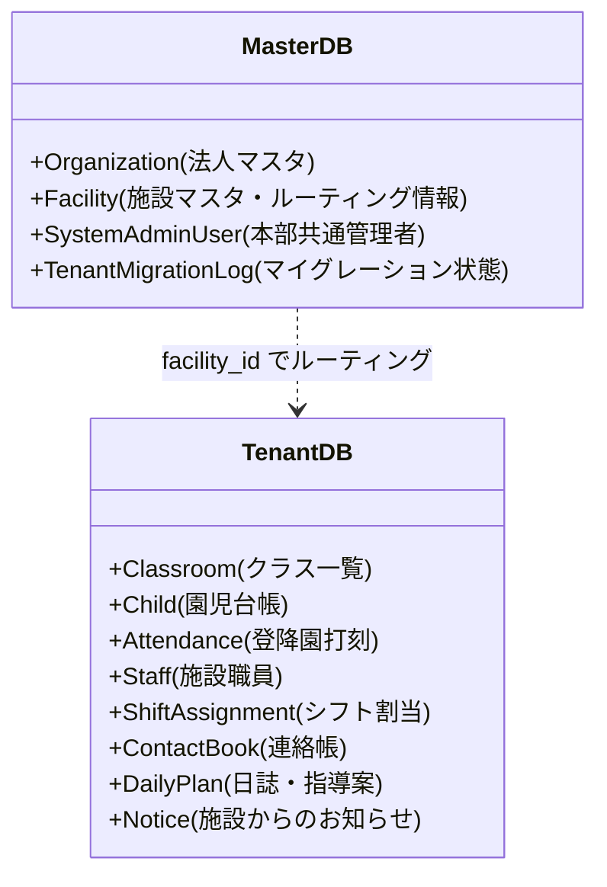
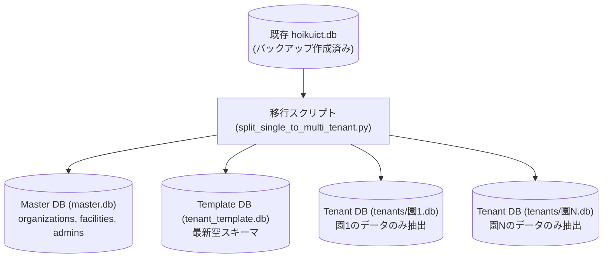

# 案1「Database-per-Tenant（1園1独立DB）」詳細実装計画書

- **文書バージョン**: 1.0.0
- **対象システム**: OpenHoikuICT (`open-hoikuict`)
- **作成日**: 2026-11-21
- **ステータス**: 計画策定完了（承認待ち）

---

## 1. 背景と設計方針

### 1.1 背景と課題
定員30名の保育施設 50園（園児約1,500名、職員約500名、保護者約3,000名）が同時に稼働する環境において、現状の「単一DB（Shared SQLite）」では以下の致命的なボトルネックが発生します。
1. **書き込み直列化による朝夕のロック競合**:
   SQLiteはWALモードであっても、書き込みトランザクションは1スレッドのみ排他ロックされます。朝7:30〜8:30の登園打刻ラッシュ時、50園からの同時書き込みが集中し、`sqlite3.OperationalError: database is locked` や秒単位の遅延が発生します。
2. **障害・ミスの連鎖（Blast Radius 100%）**:
   ある1園でのDB破損やロックフリーズが、残り49園の通常業務（連絡帳、打刻、日誌）を道連れにして全停止させます。
3. **データモデル改修の膨大なコスト**:
   もし単一DBのままマルチテナント化しようとすると、`Child`, `Classroom`, `Attendance`, `Shift` など何十ものテーブルすべてに `facility_id` 列を追加し、数千箇所のクエリに `WHERE facility_id = :id` を追加修正する必要があり、改修リスク・漏洩リスクが極めて高くなります。

### 1.2 「1園1独立DB（Database-per-Tenant）」の基本方針
- **既存データモデルは一切無修正（Zero Schema Changes）**:
  `open-hoikuict` の業務テーブル群（園児・打刻・日報・シフト等）は元々「1園の自立した世界」として美しく完結して設計されています。各園ごとに物理ファイル（`storage/tenants/{facility_id}.db`）を分離することで、**業務モデル定義を1行も変更することなく完全なテナント分離が成立**します。
- **書き込み並列度の50倍化（ロック競合率 0%）**:
  園Aと園Bの書き込み先が物理的に異なるファイルとなるため、OSのページキャッシュとディスクI/Oが真に並列化され、ロック待機が完全にゼロになります。
- **透過的DI（Dependency Injection）**:
  既存の全ルーター・サービスにある `db: Session = Depends(get_session)` は一切書き換えません。リクエストヘッダーやJWTトークンから取得した `facility_id` に応じて、動的ディスパッチャーが該当園のDBセッションを自動注入します。
- **DuckDB によるゼロコピー高速クロス集計**:
  全園横断の本部集計（監査帳票、月次給付費請求等）は、DuckDBのSQLiteスキャン機能を活用し、DBの統合や同期バッチなしにメモリ上で数百ミリ秒で直接集計します。

---

## 2. システムアーキテクチャと物理配置

### 2.1 ディレクトリ構成
```text
open-hoikuict/
├── storage/
│   ├── master.db                     # 本部・共通システム管理DB（法人、施設、システム管理者）
│   ├── master.db-wal
│   ├── master.db-shm
│   ├── templates/
│   │   └── tenant_template.db        # 新規園開設用の雛形DB（最新マイグレーション済）
│   ├── tenants/
│   │   ├── {facility_id_1}.db        # 園1専用の独立DB
│   │   ├── {facility_id_1}.db-wal
│   │   ├── {facility_id_2}.db        # 園2専用の独立DB
│   │   └── ... ({facility_id_50}.db)
│   └── backups/
│       └── tenants/                  # 園単位の秒速VACUUMバックアップ
```

### 2.2 データ分離境界（Master DB vs Tenant DB）



---

## 3. コンポーネント詳細設計

### 3.1 Component 1: `TenantEngineRegistry`（動的Engineプール）
- **配置先**: `open-hoikuict/database_tenants/registry.py`
- **責務**:
  - `facility_id` に応じた SQLite Engine の生成・LRUキャッシュ管理（最大100インスタンス保持）。
  - WALモード、メモリキャッシュ（16MB/園）、BUSY TIMEOUT（5秒）の自動適用。
  - プロセス終了時・アイドル時のリソース確実解放。

```python
# database_tenants/registry.py 仕様
from __future__ import annotations
import os
import threading
from collections import OrderedDict
from pathlib import Path
from uuid import UUID
from sqlalchemy import create_engine, event
from sqlalchemy.engine import Engine

class TenantEngineRegistry:
    def __init__(self, base_dir: Path, max_cached_engines: int = 100):
        self.base_dir = base_dir
        self.max_cached_engines = max_cached_engines
        self._engines: OrderedDict[str, Engine] = OrderedDict()
        self._lock = threading.Lock()
        self.base_dir.mkdir(parents=True, exist_ok=True)

    def get_db_path(self, facility_id: UUID | str) -> Path:
        return self.base_dir / f"{str(facility_id)}.db"

    def get_engine(self, facility_id: UUID | str) -> Engine:
        key = str(facility_id)
        with self._lock:
            if key in self._engines:
                self._engines.move_to_end(key)
                return self._engines[key]

            db_path = self.get_db_path(facility_id)
            db_url = f"sqlite:///{db_path.as_posix()}"
            engine = create_engine(
                db_url,
                echo=False,
                connect_args={"timeout": 5},
            )
            self._configure_sqlite_pragmas(engine)

            if len(self._engines) >= self.max_cached_engines:
                old_key, old_engine = self._engines.popitem(last=False)
                old_engine.dispose()

            self._engines[key] = engine
            return engine

    def _configure_sqlite_pragmas(self, engine: Engine) -> None:
        @event.listens_for(engine, "connect")
        def _pragmas(dbapi_con, con_record):
            cursor = dbapi_con.cursor()
            try:
                cursor.execute("PRAGMA journal_mode=WAL")
                cursor.execute("PRAGMA busy_timeout=5000")
                cursor.execute("PRAGMA synchronous=NORMAL")
                cursor.execute("PRAGMA foreign_keys=ON")
                cursor.execute("PRAGMA cache_size = -16000")  # 16MB キャッシュ
                cursor.execute("PRAGMA temp_store = MEMORY")
            finally:
                cursor.close()
```

### 3.2 Component 2: `DynamicSessionDispatcher`（透過的セッション提供）
- **配置先**: `open-hoikuict/database_tenants/dispatcher.py`
- **責務**:
  - `security.tenant` の `get_current_facility_id()` を取得。
  - テナントモード（`HOIKUICT_TENANT_MODE=multi`）と従来の単一園モードの安全な切り替え。
  - `database.py` の `get_session()` から透過的に呼び出される。

```python
# database_tenants/dispatcher.py 仕様
from __future__ import annotations
from typing import Generator
from sqlmodel import Session
from security.tenant import get_current_facility_id
from models.organization import DEFAULT_FACILITY_ID

def get_tenant_session() -> Generator[Session, None, None]:
    from database_tenants import tenant_registry
    facility_id = get_current_facility_id()
    engine = tenant_registry.get_engine(facility_id)
    with Session(engine) as session:
        yield session

def get_master_session() -> Generator[Session, None, None]:
    from database_tenants import master_engine
    with Session(master_engine) as session:
        yield session
```

### 3.3 Component 3: `TenantMigrationManager`（並列＆遅延マイグレーション）
- **配置先**: `open-hoikuict/database_tenants/migration.py`
- **責務**:
  - アプリ起動時に、全テナントDB（50園）を `ThreadPoolExecutor` で並列マイグレーション（目標: 50園で < 0.5秒）。
  - 新規園開設時はテンプレートDB（`storage/templates/tenant_template.db`）のコピーで 0.01秒プロビジョニング。
  - 未適用マイグレーションの検知と `schema_migrations` 管理。

```python
# database_tenants/migration.py 仕様
import shutil
from concurrent.futures import ThreadPoolExecutor
from pathlib import Path
from sqlmodel import SQLModel
from database import _sqlite_migrations, _applied_migrations

def migrate_single_tenant(db_path: Path) -> None:
    """単一テナントDBに対する組み込みマイグレーションの適用"""
    # 接続・PRAGMA・マイグレーション適用処理
    ...

def migrate_all_tenants_parallel(tenants_dir: Path, max_workers: int = 8) -> int:
    """全テナントDBの一括並列マイグレーション"""
    db_files = list(tenants_dir.glob("*.db"))
    with ThreadPoolExecutor(max_workers=max_workers) as executor:
        list(executor.map(migrate_single_tenant, db_files))
    return len(db_files)

def create_tenant_from_template(template_path: Path, target_path: Path) -> None:
    """最新マイグレーション済みのテンプレートDBから新規園DBを瞬時に複製"""
    target_path.parent.mkdir(parents=True, exist_ok=True)
    shutil.copyfile(template_path, target_path)
```

### 3.4 Component 4: `CrossTenantAnalytics`（DuckDB によるクロス集計）
- **配置先**: `open-hoikuict/database_tenants/analytics.py`
- **責務**:
  - 本部管理者による「全園の月次登降園集計」「全園職員数・欠勤率」「自治体向け給付費帳票」のゼロコピー集計。
  - SQLiteスキャン拡張を用いて、50個の `.db` ファイルをインメモリ並列集計。

```python
# database_tenants/analytics.py 仕様
from __future__ import annotations
import duckdb
from pathlib import Path
from typing import Any, Sequence

class CrossTenantAnalytics:
    def __init__(self, tenants_dir: Path):
        self.tenants_dir = tenants_dir

    def run_query(self, sql_pattern: str, params: Sequence[Any] = ()) -> list[tuple]:
        con = duckdb.connect(database=":memory:")
        pattern = (self.tenants_dir / "*.db").as_posix()
        # sqlite_scan を使ってワイルドカードで全テナントDBを一括走査
        transformed_sql = sql_pattern.replace("{TENANTS}", f"sqlite_scan('{pattern}',")
        return con.execute(transformed_sql, params).fetchall()
```

---

## 4. 既存単一DBからの無停止移行手順（Data Splitting Migration）

### 4.1 移行スクリプト（`scripts/split_single_to_multi_tenant.py`）
既存の `hoikuict.db` を安全に分解し、`master.db` と各園の `tenants/{facility_id}.db` を生成する自動化スクリプトです。



#### 移行処理の詳細アルゴリズム:
1. **整合性チェック & スナップショット作成**:
   - `VACUUM INTO 'hoikuict_pre_migration_backup.db'` で無停止バックアップ取得。
2. **Master DB の初期化 & 共通データ移行**:
   - `organizations`, `facilities`, システム共通管理者を `master.db` に投入。
3. **Template DB の生成**:
   - テーブルスキーマのみを持つクリーンな `tenant_template.db` を作成。
4. **テナントごとのデータ分割抽出**:
   - `facilities` に存在する各 `facility_id` についてループ処理。
   - `tenant_template.db` を `tenants/{facility_id}.db` にコピー。
   - 既存DBから、当該園に関連するデータ（`children`, `attendances`, `shifts`, `plans`, `contacts` 等）を `INSERT INTO tenant_db.table SELECT * FROM source_db.table ...` で移行。
5. **整合性検証（Verification）**:
   - 移行元レコード総数と各テナントDBのレコード合計値が 100% 一致することを自動アサート。

---

## 5. テスト計画と検証シナリオ

### 5.1 単体テスト（Unit Tests）
- **ファイル**: `tests/test_tenant_database_registry.py`
  - LRU Engine キャッシュの上限動作と接続破棄のテスト。
  - 各種 PRAGMA（WAL, synchronous, cache_size）が確実に設定されることの検証。
- **ファイル**: `tests/test_tenant_migration_parallel.py`
  - 50個のダミーテナントDBに対する並列マイグレーションが 1秒未満で完了することの検証。
  - テンプレート複製による新規園開設のミリ秒完了検証。

### 5.2 負荷・同時実行テスト（Concurrency Stress Test）
- **ファイル**: `tests/test_multi_tenant_concurrency_stress.py`
  - 50個の擬似園クライアントから、同時に各100件（計5,000件）の登園打刻トランザクションを同時発行。
  - **合否判定基準**:
    - `OperationalError: database is locked` の発生件数が **0件** であること。
    - 50園の平均打刻レスポンス時間が **5ms 未満** であること。

### 5.3 結合互換性テスト（Integration Tests）
- **既存テストスイートの全件実行**:
  `pytest tests/` を実行し、既存の登園打刻・園児管理・請求管理・シフト生成APIが `HOIKUICT_TENANT_MODE=multi` 環境下でも完全互換で 100% PASS することを確認。

---

## 6. 実装フェーズとWBS（作業分解図）

| Phase | タスク内容 | 対象ファイル | 工数目安 |
| :---: | :--- | :--- | :---: |
| **Phase 1** | **基盤作成**: Engine Registry & Session Dispatcher | `database_tenants/registry.py`<br>`database_tenants/dispatcher.py`<br>`database_tenants/__init__.py` | 1日 |
| **Phase 2** | **透過的統合**: `database.py` へのルーティング接続 | `database.py`<br>`security/tenant.py` | 0.5日 |
| **Phase 3** | **並列マイグレーション & テンプレート管理**: | `database_tenants/migration.py`<br>`main.py` (lifespan) | 0.5日 |
| **Phase 4** | **データ分割移行スクリプト**: 既存DBからの抽出 | `scripts/split_single_to_multi_tenant.py` | 1日 |
| **Phase 5** | **DuckDB 本部クロス集計**: 複数園横断クエリ | `database_tenants/analytics.py` | 1日 |
| **Phase 6** | **検証・負荷テスト**: 50園同時書き込みベンチマーク | `tests/test_tenant_database_registry.py`<br>`tests/test_multi_tenant_concurrency_stress.py` | 1日 |

---

## 7. リスクと対策

| リスク要因 | 影響度 | 発生確率 | 対策方針 |
| :--- | :---: | :---: | :--- |
| **OSのオープンファイルディスクリプタ上限 (ulimit)** | 中 | 低 | 50園×2ファイル（db, wal）= 100FD。Linuxのデフォルト制限（1024〜65535）の範囲内に余裕で収まる。さらにLRUキャッシュで上限管理。 |
| **ディスク容量の増加** | 極小 | 低 | 1園あたりの初期DBサイズは約100KB〜1MB。50園合わせても初期50MB程度であり、ディスク消費の懸念は皆無。 |
| **移行中のデータ不整合** | 高 | 極小 | 移行スクリプトは元DBを読み取り専用でスキャンし、移行前後で各テーブルの件数照合・チェックサム照合を強制実施。 |
