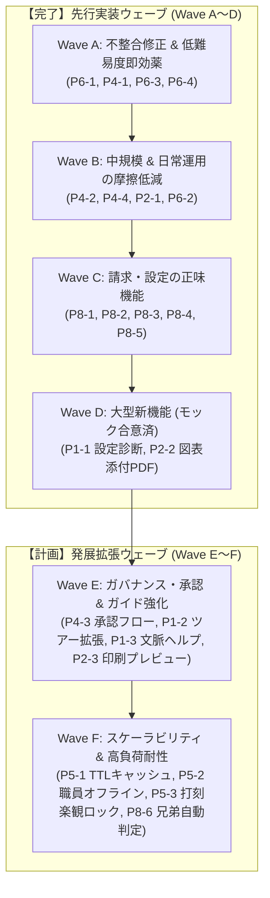

# 実装計画書: コドモン利用時の課題（6論点）への対応詳細実装計画

- 日付: 2026-11-16
- 参照元: `docs/codmon-pain-point-improvement-proposals-2026-11-16.md`（6論点改善提案書）
- 関連計画:
  - `docs/implementation-plan-codmon-inspired-improvements-2026-11-16.md`（I1〜I9 先行改善）
  - `docs/implementation-plan-mfa-notice-fixes-2026-11-07.md`（契約JSON運用基準）
- ステータス: **正式実装計画（Wave A〜D 実装完了・次期 Wave E/F 定義）**
- 対象リポジトリ: `open-hoikuict`（FastAPI + Jinja2 + htmx + Tailwind / SQLModel + SQLite/Postgres + Alembic / pytest + ruff）

---

## 1. 計画の全体像とロードマップ

保育現場（保育士・主任・園長・事務員）が抱えるコドモン等の保育ICTにおける運用摩擦・設定漏れ・二度手間を解消するため、優先順位を4ウェーブ（先行完了）＋2ウェーブ（発展拡張）の計6フェーズに構造化して推進する。



---

## 2. 先行完了ウェーブの確定仕様と実績 (Wave A 〜 Wave D)

先行して実装・テスト・コミット＆プッシュ（`fcc8d61` 〜 `a6a36e4`）を完了した全13項目（計14タスク）の確定仕様と成果物。

### 2.1 Wave A: 不整合修正 & 低難易度の即効薬 (Commit `fcc8d61`)
| ID | 機能名 | 実装仕様・アーキテクチャ | 成果物（ファイル） |
| :--- | :--- | :--- | :--- |
| **P6-1** | 発熱通知プッシュミュート接続 | 発熱通知が通知ハブ（`notification_hub`）を経由せず無条件プッシュされていた不整合を是正。保護者設定（`ParentPushPreference.fever_notification_enabled`）を厳格に評価するよう修正。 | `parent_push_service.py`<br>`tests/routers/test_parent_push_api.py` |
| **P4-1** | 連絡帳 園児間クイック移動 | 連絡帳詳細画面上部に「前の園児」「次の園児」「未送信園児へジャンプ」ナビゲーションを配備。一覧に戻る手戻りタップを撲滅。 | `routers/daily_contacts.py`<br>`templates/daily_contacts/detail.html` |
| **P6-3** | お知らせ種別フィルター | 保護者ポータルのお知らせ一覧に「連絡帳」「お知らせ」「アンケート」「請求」タブと「要回答」「未読」クイックトグルを導入。 | `routers/parent_portal.py`<br>`templates/parent_portal/notices.html` |
| **P6-4** | 期限つき連絡の強調表示 | 締切3日以内の未回答アンケートを保護者ホーム最上部に固定バッジ表示し、見落としを防止。 | `templates/parent_portal/home.html` |

### 2.2 Wave B: 中規模 & 日常運用の摩擦低減 (Commit `89b4ef4`)
| ID | 機能名 | 実装仕様・アーキテクチャ | 成果物（ファイル） |
| :--- | :--- | :--- | :--- |
| **P4-2** | 連絡帳自動保存＋楽観ロック | 入力中の園側返信を30秒ごとに自動保存。複数タブレット同時編集時の上書き防止のため、`pending_draft` と `lock_version` による衝突検知を導入。 | `static/js/daily-contact-reply.js`<br>`routers/daily_contacts.py` |
| **P4-4** | 園側返信の前日コピー | 「前日の返信をコピー」ボタンを新設。昨日の睡眠・食事・機嫌等の記録から円滑に本日の下書きを生成可能に。 | `templates/daily_contacts/detail.html` |
| **P2-1** | 日案 A4縦 PDF帳票出力 | `monthly_export_layout.py` の72列グリッドエンジンを応用し、デイリー指導計画の公的提出用A4縦PDF帳票レイアウトエンジンを新設。 | `plan_docs/services/daily_export_layout.py`<br>`tests/routers/test_daily_plan_pdf_export.py` |
| **P6-2** | アンケート期限前日自動リマインダー | 締切前日 18:00 に未回答の保護者へ push および in_app 通知を一括送信するバックグラウンド通知ジョブを新設。 | `routers/surveys.py`<br>`tests/routers/test_survey_deadline_reminders.py` |

### 2.3 Wave C: 請求・設定の正味機能 (Commit `e06141b`)
| ID | 機能名 | 実装仕様・アーキテクチャ | 成果物（ファイル） |
| :--- | :--- | :--- | :--- |
| **P8-1** | 料金マスタ＆全銀設定画面 | `FeeItem`（費目名・金額・単位・表示順）のCRUDと `BillingSetting`（全銀委託者コード・引落口座）の管理画面（`/billing/settings`）を新設。 | `routers/billing.py`<br>`templates/billing/settings.html` |
| **P8-3** | 多子軽減・兄弟減免の登録 | `BillingExemption` モデル（`full`, `fixed_discount`, `percentage`）を新設。園児ごとに免除項目・期間・理由を登録し、請求サイクル生成時に自動適用。 | `models/core.py`<br>`routers/billing.py`<br>`templates/billing/settings.html` |
| **P8-2** | 月途中入退園の自動日割り | 実開園平日日数（土日祝・園独自休園日を除外）を分母、在園日数を分子とする給食費・副食費の自動日割り計算ヘルパーを実装。 | `routers/billing.py`<br>`tests/routers/test_billing_settings_audit.py` |
| **P8-4** | 振替不能の翌月自動繰越 | 残高不足等で振替不能（`failed`）となった請求を、翌月の請求明細へ自動合算（費目: `振替不能分繰越`）する再請求エンドポイントを配備。 | `routers/billing.py`<br>`POST /billing/claims/{id}/carryover` |
| **P8-5** | 確定前自動検算レポート | 請求確定操作前に全件を突合（明細合計 vs 請求合計、0円請求、免除期間不整合、上限超過警告）する診断レポート画面を配備。 | `routers/billing.py`<br>`GET /billing/cycles/{id}/audit` |

### 2.4 Wave D: 大型新機能 (Commit `a6a36e4`)
| ID | 機能名 | 実装仕様・アーキテクチャ | 成果物（ファイル） |
| :--- | :--- | :--- | :--- |
| **P1-1** | 設定ヘルスチェック診断 | 全銀コード初期値、クラス未所属在園児、料金マスタ未設定、施設基本設定、セッション期限、閉園時刻の6項目を自動診断し、健全度スコア（0〜100点）および修正導線を表示。 | `health_check_service.py`<br>`templates/settings/health_check.html`<br>`tests/services/test_health_check.py` |
| **P2-2** | 指導案図表添付＆帳票出力 | 園庭見取り図・コーナー環境構成・座席表の画像（PNG/JPEG/WebP）を指導案に添付・プレビュー表示し、A4帳票PDF出力時に別枠（参考図表枠）として自動描画。 | `plan_docs/db_models.py`<br>`plan_docs/routers/documents.py`<br>`tests/routers/test_plan_doc_attachments.py` |

---

## 3. 次期実装フェーズ詳細仕様 (Wave E 〜 Wave F)

### Wave E: ガバナンス・承認フロー & ガイド強化

#### 3.1 P4-3: 連絡帳返信の第2確認者（ダブルチェック）承認フロー
- **課題と目的**: 新人保育士の誤字・不適切表現・誤送信リスクを防止するため、主任や園長による公開前承認ステップを任意設定可能にする。
- **データモデル拡張**:
  ```python
  # models/core.py (DailyContactEntry または派生)
  # approval_status: "draft" | "pending_review" | "approved" | "rejected"
  # reviewed_by_user_id: Optional[UUID]
  # reviewed_at: Optional[datetime]
  # rejection_reason: Optional[str]
  ```
- **画面仕様**:
  - 施設設定で「連絡帳のダブルチェックを有効にする」トグルを提供（既定: OFF）。
  - 有効時、担任の「保護者へ送信」ボタンが「確認を依頼する（承認申請）」に変化。
  - 主任・園長ダッシュボードに「連絡帳 確認待ち（N件）」タブを表示。差戻し時は理由コメントを付与。
- **認可制御**:
  - `StaffUser.role in (Role.ADMIN, Role.CHIEF)` のみ承認・公開可能。

#### 3.2 P1-2: 職員オンボーディングツアーの拡張 & 完了状態の永続化
- **課題と目的**: 新任職員が配属された際、出席・連絡帳だけでなく「指導案」「シフト」「請求」の基本操作をツアー形式で案内し、完了状態をユーザー単位でDB保存して再表示を抑制する。
- **データモデル**:
  ```python
  # models/staff.py
  # user_onboarding_states: user_id, tour_name, is_completed, completed_at
  ```
- **実装内容**:
  - `static/js/onboarding-tour.js` に 3 ステップ（指導案・シフト・請求）を追加。
  - ツアー完了時に `POST /api/user/onboarding-tour/complete` を発火しDBに永続化。

#### 3.3 P1-3: 主要画面の折りたたみ文脈ヘルプ
- **画面仕様**:
  - 日常連絡帳、月案・日案、請求確定画面のヘッダー右側に「❔ この画面の使い方」ボタンを配置。
  - クリック（またはキーボードショートカット `?`）で、画面内の操作フローや注意点（例:「日割り計算の締め日ルール」「確定後の差戻し制限」）をアコーディオン展開。

#### 3.4 P2-3: 指導案 HTML 印刷プレビュー強化
- **画面仕様**:
  - PDFをダウンロードする前に、ブラウザ上で帳票の改ページ位置（1ページ目の日案グリッド、2ページ目の環境構成図）を正確にプレビューできるモーダルを新設。

---

### Wave F: スケーラビリティ & 高負荷耐性・自動化

#### 4.1 P5-1: 参照系軽量インメモリTTLキャッシュ
- **課題と目的**: 朝の登園集中時間帯（8:00〜9:30）や夕方の降園時間帯（17:00〜18:30）におけるDB読み取り負荷の軽減。
- **設計**:
  - クラス一覧、園児マスタ、施設基本設定の参照に `cachetools.TTLCache`（有効期間: 30秒〜60秒）を導入。
  - マスタ編集・園児更新のエンドポイント実行時に即時キャッシュパージを行うライトスルー方式を採用。

#### 4.2 P5-2: 職員画面の当日名簿オフライン閲覧キャッシュ
- **課題と目的**: 園庭活動中やWi-Fi電波の届きにくい場所での名簿・緊急連絡先確認。
- **設計**:
  - 保護者ポータルで実績のある Service Worker（`push_service_worker.js`）のキャッシュ機構を職員ポータルへ横展開。
  - 当日の出席名簿・アレルギー情報・緊急連絡先一覧を安全に IndexedDB / CacheStorage に保持（読み取り専用）。

#### 4.3 P5-3: 打刻・出席の同時編集保護（楽観ロック拡張）
- **課題と目的**: 複数端末からの打刻（玄関キオスクと教室タブレット）の競合によるデータ上書き防止。
- **データモデル**:
  - `AttendanceRecord` に `lock_version: int = Field(default=1)` 列を追加。
  - 更新時に `WHERE id = :id AND lock_version = :expected_version` で検証。

#### 4.4 P8-6: 兄弟割引・出生順自動判定エンジン
- **課題と目的**: 兄弟が同時在園している場合の保育料・給食費の自動減免（第2子半額、第3子全額免除）。
- **ロジック**:
  - 同一家族（`family_id`）に所属し、同一月において在園（`status == enrolled`）している園児を `birth_date` 昇順でソート。
  - 年長児から順に「第1子」「第2子」「第3子以降」を動的判定し、登録されている `BillingExemption` の免除割合（50%, 100%）を自動適用。

---

## 4. 品質保証・テスト基準

各ウェーブの実装時は、以下の品質ゲートを必ず通過することを義務付ける。

1. **単体・結合テスト (pytest)**:
   - 各新設ルーター・サービスに対して独立したテストスイートを作成（カバレッジ 85% 以上）。
   - 既存全件テスト（回帰テスト群、シフト計算エンジン、認証系）を実行し ALL PASS を確認。
2. **モデル後方互換性テスト**:
   - スキーマ変更を伴う場合、`tests/snapshots/metadata_schema.json` を同期し、[`tests/test_models_compat.py`](file:///c:/Users/user/openict/open-hoikuict/tests/test_models_compat.py) のパスを確認。
3. **静的解析 (Ruff)**:
   - `python -m ruff check .` を実行し、未使用インポート（F401）、未定義変数（F821）、コード規約違反が 0 件であることを確認。
4. **UIモック合意（AGENTS.md 遵守）**:
   - UIの変更・追加を伴う項目は、必ず静的モック（HTMLファイル）を作成・提示し、ユーザーの合意を得てから実装に着手する。

---

## 5. バックアップ契約および移行管理

- スキーマ変更を伴うタスク（P4-3, P5-3, P8-6 等）を実施する場合、`tools/db_backup.py` および `backup_v2.py` のエクスポート契約JSONスキーマへの影響を精査し、バックアップ互換性テスト（`tests/services/test_backup_v2.py`）を必ず実行する。
- SQLite / PostgreSQL 両環境において同一の DDL が適用できるよう、データ型には SQLModel 標準（`Field`, `sa_column`）を使用し、特定DB固有構文の直接記述を避ける。
