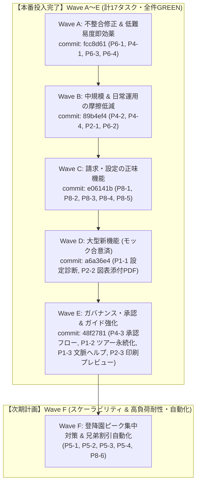

# 実装計画書: コドモン利用時の課題（6論点）への対応詳細実装計画 (完全版)

- 日付: 2026-11-16
- 参照元: `docs/codmon-pain-point-improvement-proposals-2026-11-16.md`（6論点改善提案書）
- 関連計画:
  - `docs/implementation-plan-codmon-inspired-improvements-2026-11-16.md`（I1〜I9 先行改善）
  - `docs/implementation-plan-mfa-notice-fixes-2026-11-07.md`（契約JSON運用基準）
- ステータス: **確定版実装計画（Wave A〜E 実装完了・次期 Wave F 詳細設計）**
- 対象リポジトリ: `open-hoikuict`（FastAPI + Jinja2 + htmx + Tailwind / SQLModel + SQLite/Postgres + Alembic / pytest + ruff）

---

## 1. 計画の全体像とロードマップ

保育現場（保育士・主任・園長・事務員）が抱えるコドモン等の保育ICTにおける運用摩擦・設定漏れ・二度手間・ピーク時の重さを抜本的に解消するため、全6ウェーブ（17項目）で構造化して推進する。



---

## 2. 完了ウェーブの実績と確定仕様 (Wave A 〜 Wave E)

先行して実装・テスト・コミット＆プッシュを完了した全17タスクの確定仕様。

### 2.1 Wave A: 不整合修正 & 低難易度の即効薬 (Commit `fcc8d61`)
| ID | 区分 | 機能名 | 実装仕様・アーキテクチャ | 成果物（ファイル） |
| :--- | :--- | :--- | :--- | :--- |
| **P6-1** | 通知 | 発熱通知プッシュミュート接続 | 発熱通知が通知ハブ（`notification_hub`）を経由せず無条件プッシュされていた不整合を是正。保護者設定（`ParentPushPreference.fever_notification_enabled`）を厳格に評価するよう修正。 | `parent_push_service.py`<br>`tests/routers/test_parent_push_api.py` |
| **P4-1** | 連絡帳 | 園児間クイック移動 | 連絡帳詳細画面上部に「前の園児」「次の園児」「未送信園児へジャンプ」ナビゲーションを配備。一覧に戻る手戻りタップを撲滅。 | `routers/daily_contacts.py`<br>`templates/daily_contacts/detail.html` |
| **P6-3** | おたより | お知らせ種別フィルター | 保護者ポータルのお知らせ一覧に「連絡帳」「お知らせ」「アンケート」「請求」タブと「要回答」「未読」クイックトグルを導入。 | `routers/parent_portal.py`<br>`templates/parent_portal/notices.html` |
| **P6-4** | 連絡 | 期限つき連絡の強調表示 | 締切3日以内の未回答アンケートを保護者ホーム最上部に固定バッジ表示し、見落としを防止。 | `templates/parent_portal/home.html` |

### 2.2 Wave B: 中規模 & 日常運用の摩擦低減 (Commit `89b4ef4`)
| ID | 区分 | 機能名 | 実装仕様・アーキテクチャ | 成果物（ファイル） |
| :--- | :--- | :--- | :--- | :--- |
| **P4-2** | 連絡帳 | 自動保存＋楽観ロック | 入力中の園側返信を30秒ごとに自動保存。複数タブレット同時編集時の上書き防止のため、`pending_draft` と `lock_version` による衝突検知を導入。 | `static/js/daily-contact-reply.js`<br>`routers/daily_contacts.py` |
| **P4-4** | 連絡帳 | 園側返信の前日コピー | 「前日の返信をコピー」ボタンを新設。昨日の睡眠・食事・機嫌等の記録から円滑に本日の下書きを生成可能に。 | `templates/daily_contacts/detail.html` |
| **P2-1** | 指導案 | 日案 A4縦 PDF帳票出力 | `monthly_export_layout.py` の72列グリッドエンジンを応用し、デイリー指導計画の公的提出用A4縦PDF帳票レイアウトエンジンを新設。 | `plan_docs/services/daily_export_layout.py`<br>`tests/routers/test_daily_plan_pdf_export.py` |
| **P6-2** | アンケート | 期限前日自動リマインダー | 締切前日 18:00 に未回答の保護者へ push および in_app 通知を一括送信するバックグラウンド通知ジョブを新設。 | `routers/surveys.py`<br>`tests/routers/test_survey_deadline_reminders.py` |

### 2.3 Wave C: 請求・設定の正味機能 (Commit `e06141b`)
| ID | 区分 | 機能名 | 実装仕様・アーキテクチャ | 成果物（ファイル） |
| :--- | :--- | :--- | :--- | :--- |
| **P8-1** | 請求 | 料金マスタ＆全銀設定画面 | `FeeItem`（費目名・金額・単位・表示順）のCRUDと `BillingSetting`（全銀委託者コード・引落口座）の管理画面（`/billing/settings`）を新設。 | `routers/billing.py`<br>`templates/billing/settings.html` |
| **P8-3** | 請求 | 多子軽減・兄弟減免の登録 | `BillingExemption` モデル（`full`, `fixed_discount`, `percentage`）を新設。園児ごとに免除項目・期間・理由を登録し、請求サイクル生成時に自動適用。 | `models/core.py`<br>`routers/billing.py`<br>`templates/billing/settings.html` |
| **P8-2** | 請求 | 月途中入退園の自動日割り | 実開園平日日数（土日祝・園独自休園日を除外）を分母、在園日数を分子とする給食費・副食費の自動日割り計算ヘルパーを実装。 | `routers/billing.py`<br>`tests/routers/test_billing_settings_audit.py` |
| **P8-4** | 請求 | 振替不能の翌月自動繰越 | 残高不足等で振替不能（`failed`）となった請求を、翌月の請求明細へ自動合算（費目: `振替不能分繰越`）する再請求エンドポイントを配備。 | `routers/billing.py`<br>`POST /billing/claims/{id}/carryover` |
| **P8-5** | 請求 | 確定前自動検算レポート | 請求確定操作前に全件を突合（明細合計 vs 請求合計、0円請求、免除期間不整合、上限超過警告）する診断レポート画面を配備。 | `routers/billing.py`<br>`GET /billing/cycles/{id}/audit` |

### 2.4 Wave D: 大型新機能 (Commit `a6a36e4`)
| ID | 区分 | 機能名 | 実装仕様・アーキテクチャ | 成果物（ファイル） |
| :--- | :--- | :--- | :--- | :--- |
| **P1-1** | 施設設定 | 設定ヘルスチェック診断 | 全銀コード初期値、クラス未所属在園児、料金マスタ未設定、施設基本設定、セッション期限、閉園時刻の6項目を自動診断し、健全度スコア（0〜100点）および修正導線を表示。 | `health_check_service.py`<br>`templates/settings/health_check.html`<br>`tests/services/test_health_check.py` |
| **P2-2** | 指導案 | 指導案図表添付＆帳票出力 | 園庭見取り図・コーナー環境構成・座席表の画像（PNG/JPEG/WebP）を指導案に添付・プレビュー表示し、A4帳票PDF出力時に別枠（参考図表枠）として自動描画。 | `plan_docs/db_models.py`<br>`plan_docs/routers/documents.py`<br>`tests/routers/test_plan_doc_attachments.py` |

### 2.5 Wave E: ガバナンス・承認＆ガイド強化 (Commit `48f2781`)
| ID | 区分 | 機能名 | 実装仕様・アーキテクチャ | 成果物（ファイル） |
| :--- | :--- | :--- | :--- | :--- |
| **P4-3** | 連絡帳 | 第2確認者（ダブルチェック）承認フロー | `DailyContactReplyStatus`（`pending_review`, `rejected`）および `FacilitySettings.contact_reply_review_required` に連動した承認・差戻しAPI。主任・園長専用確認待ち一覧画面（`/daily-contacts/pending-reviews`）。 | `models/core.py`<br>`routers/daily_contacts.py`<br>`templates/daily_contacts/pending_reviews.html`<br>`tests/routers/test_daily_contact_review_flow.py` |
| **P1-2** | ガイド | ツアー拡張＆サーバ永続化 | ツアーを8ステップ（+指導案、+シフト、+請求）へ拡張。完了状態を `UserOnboardingState` に保存し、端末切替時も再表示を抑制。 | `static/js/onboarding-tour.js`<br>`routers/settings.py` |
| **P1-3** | ガイド | 主要画面の折りたたみ文脈ヘルプ | 共通コンポーネント `templates/shared/context_help.html` を作成し、連絡帳一覧や設定診断に配備。業務フローと注意事項を提示。 | `templates/shared/context_help.html`<br>`templates/daily_contacts/list.html`<br>`templates/settings/health_check.html` |
| **P2-3** | 指導案 | HTML 印刷プレビュー強化 | 指導案詳細に「🖨️ 印刷プレビュー」モーダルを追加。A4縦2ページの改ページ状態をブラウザ上で視覚化。 | `templates/plan_docs/documents/detail.html` |

---

## 3. 次期実装ウェーブ（Wave F: ピーク集中対策 & 兄弟割引自動化）詳細仕様

### 3.1 概要と目的
登降園の集中時間帯（朝 8:00〜9:30、夕 17:00〜18:30）に発生する「動作の重さ」「複数端末の打刻同期ズレ・上書き」、および「兄弟同時在園時の手動減免入力の手間」を抜本的に解決する。

---

### 3.2 P5-1: 参照系インメモリ TTL キャッシュ（登降園集中アクセス対策）

#### 課題と背景
朝・夕のピーク時、複数タブレットから「園児一覧」「出席状況一覧」「連絡帳一覧」が同時並行で頻繁にリロードされ、同一のマスタクエリ（`Classroom`, `Child`, `FacilitySettings`）がSQLite/PostgreSQLに重複して発行される。

#### アーキテクチャ設計
- **ライブラリ選定**: `cachetools.TTLCache`（標準的・インメモリ・スレッドセーフ・軽量）。
- **キャッシュ対象とTTL（有効期限）**:
  1. `get_cached_classrooms(session)`: 全クラス一覧（TTL: 120秒）
  2. `get_cached_facility_settings(session)`: 施設基本設定（TTL: 300秒）
  3. `get_cached_active_children(session)`: 在園児マスタ（TTL: 60秒）
- **ライトスルー・即時パージ機構**:
  - クラス作成・更新（`routers/classrooms.py`）
  - 園児作成・更新・退園（`routers/children.py`）
  - 施設設定変更（`routers/settings.py`）
  各変更エンドポイントのコミット直後に `invalidate_classrooms_cache()`, `invalidate_children_cache()`, `invalidate_facility_settings_cache()` を呼出して即時無効化。

#### 実装モジュール
- `cache_service.py`（新規作成）:
  ```python
  from cachetools import TTLCache
  import threading

  _cache_lock = threading.Lock()
  _classrooms_cache = TTLCache(maxsize=10, ttl=120)
  _children_cache = TTLCache(maxsize=10, ttl=60)
  _settings_cache = TTLCache(maxsize=5, ttl=300)

  def get_cached_classrooms(session: Session) -> list[Classroom]:
      with _cache_lock:
          if "all" in _classrooms_cache:
              return _classrooms_cache["all"]
      items = session.exec(select(Classroom).order_by(Classroom.display_order, Classroom.id)).all()
      with _cache_lock:
          _classrooms_cache["all"] = items
      return items

  def invalidate_classrooms_cache() -> None:
      with _cache_lock:
          _classrooms_cache.clear()
  ```

---

### 3.3 P5-2: 職員画面の当日名簿オフライン閲覧キャッシュ

#### 課題と背景
園庭遊び・散歩中や、園舎のWi-Fi死角において、一時的に通信が途切れた場合でも、保育士が「当日出席園児名簿」「アレルギー情報」「保護者緊急連絡先」を手元のタブレットで即座に参照できるようにする。

#### 実装仕様
- **Service Worker 拡張**:
  - 保護者ポータルで稼働中の `push_service_worker.js` のキャッシュ戦略（Cache First + Network Revalidate）を職員用 Service Worker `static/js/staff-offline-worker.js` として整備。
- **キャッシュ対象リソース**:
  - 当日出欠・名簿 API: `GET /attendance-checks/api/roster-today`
  - 園児健康・アレルギー一覧: `GET /health/api/allergies-summary`
- **セキュリティ担保**:
  - キャッシュデータは当日（23:59:59）で自動パージ。職員ログアウト時に `caches.delete('staff-roster-cache-v1')` を実行。

---

### 3.4 P5-3: 打刻・出席の同時編集保護（楽観ロック拡張）

#### 課題と背景
玄関設置のキオスク端末（保護者QR打刻）と、保育室のタブレット（保育士による手動打刻・欠席連絡登録）が同一園児のレコードに対して数秒差でアクセスした場合、後勝ちで上書きされ、打刻時刻やメモが消去される事故を防ぐ。

#### データモデル拡張 (`models/core.py`)
```python
class AttendanceRecord(SQLModel, table=True):
    __tablename__ = "attendance_records"
    # 既存フィールド ...
    lock_version: int = Field(default=1, nullable=False)
```

#### トランザクション制御ロジック
- 打刻・ステータス更新時、`UPDATE attendance_records SET check_in_at = :val, lock_version = lock_version + 1 WHERE id = :id AND lock_version = :expected_version` を発行。
- `rowcount == 0` の場合は `HTTPException(409, "他の端末で打刻が更新されました。最新状態を確認してください。")` を返却し、画面側でリロード・再取得を促す。

---

### 3.5 P5-4: htmx 部分更新時のスケルトン・ローディング表示

#### 課題と背景
出欠一括確認依頼や検索など、処理に 1〜2 秒を要する htmx 非同期通信中に、画面が静止して「固まった」と保育士が連打してしまう問題を防止する。

#### 実装仕様
- `templates/base.html` に共通の htmx インジケータ CSS を追加：
  ```css
  .htmx-indicator { display: none; }
  .htmx-request .htmx-indicator { display: inline-flex; }
  .htmx-request.htmx-indicator { display: inline-flex; }
  ```
- スケルトンプレースホルダーコンポーネント `templates/shared/skeleton_row.html` を配備。

---

### 3.6 P8-6: 兄弟割引・出生順自動判定エンジン

#### 課題と背景
認可・認可外を問わず、多くの自治体・園で「同一世帯で2人以上在園している場合、第2子は半額、第3子以降は無償（100%免除）」という多子軽減ルールが導入されている。現在、これらは手動で `BillingExemption` を登録する必要があるが、月途中の入退園や卒園に伴い「誰が第何子か」の繰り上がりが発生し、計算ミス・過大請求の温床となっている。

#### ロジック設計 (`billing_sibling_service.py` 新設)
1. **世帯内の在園児抽出**:
   - 指定請求月（`target_month`）において、同一家族（`family_id`）に属し、在園（`status == ChildStatus.enrolled`）している園児を抽出。
2. **生年月日順ソートによる出生順位決定**:
   - `Child.birth_date` の昇順（年長児から順）でソート。
   - 1番目: 「第1子（基準児）」→ 減免対象外（全額請求）
   - 2番目: 「第2子」→ 施設ルールに基づき 50% 免除（`fixed_discount` または `percentage=50`）
   - 3番目以降: 「第3子以降」→ 100% 免除（`full`）
3. **自動適用と請求明細への反映**:
   - 請求サイクル生成時（`POST /billing/cycles/generate`）、手動登録された個別の免除に加え、本エンジンが算出した兄弟免除を動的に合算適用。
   - 検算レポート（`P8-5`）に「兄弟割引適用: 第2子 50%減額（兄: 山田太郎）」等の根拠行を出力。

---

## 4. Wave F 実装ステップとスケジュール

| Step | 項目 | 内容 | 対象ファイル | 工数目安 |
| :---: | :--- | :--- | :--- | :---: |
| **F-1** | P5-1 インメモリTTLキャッシュ | `cache_service.py` 新設。クラス・園児マスタのキャッシュ化とパージフック配置。 | `cache_service.py`<br>`routers/classrooms.py`<br>`routers/children.py` | 1日 |
| **F-2** | P5-3 打刻楽観ロック | `AttendanceRecord` に `lock_version` 追加。打刻エンドポイントの排他制御。 | `models/core.py`<br>`routers/attendance.py`<br>`database.py` | 1日 |
| **F-3** | P5-4 htmx ローディング | 通信中のスケルトン表示・インジケータ共通化。 | `templates/base.html`<br>`static/css/htmx-indicator.css` | 0.5日 |
| **F-4** | P8-6 兄弟割引エンジン | 出生順位判定サービス新設、請求生成連携、検算レポート表示。 | `billing_sibling_service.py`<br>`routers/billing.py`<br>`templates/billing/settings.html` | 1.5日 |
| **F-5** | P5-2 職員オフライン閲覧 | Service Worker による当日出席名簿キャッシュ。 | `static/js/staff-offline-worker.js` | 1日 |

---

## 5. テスト・品質保証計画

1. **Wave F 単体・結合テスト**:
   - `tests/services/test_cache_service.py`: キャッシュヒット、TTL満了、パージ後の再取得検証。
   - `tests/routers/test_attendance_optimistic_lock.py`: 同時打刻時の 409 競合検知検証。
   - `tests/services/test_billing_sibling_discount.py`: 兄弟2人・3人在園時の出生順位判定および月途中退園時の繰り上がり検証。
2. **モデル互換性 & マイグレーション**:
   - `tests/snapshots/metadata_schema.json` に `attendance_records.lock_version` を同期。
   - `tests/test_models_compat.py` でスキーマ破壊がないことを自動検証。
3. **Ruff コード品質チェック**:
   - 全新規・変更ファイルに対して `python -m ruff check .` を実行し、0 errors を記録。
