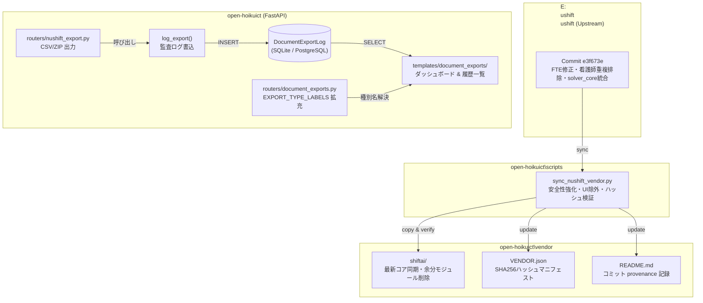

# Phase 1 詳細実装計画書
## NuShift ベンダリング同期・ドリフト解消 ＆ エクスポート監査ログ完全統合

- **作成日**: 2026-11-13
- **対象プロジェクト**:
  - `open-hoikuict` (`C:\Users\user\openict\open-hoikuict`)
  - `NuShift` (`E:\nushift\nushift`)
- **関連ドキュメント**:
  - `docs/shift-organic-integration-implementation-plan-27steps-2026-11-10.md`
  - `scripts/sync_nushift_vendor.py`
  - `vendor/nushift/README.md`
  - `REGRESSION_TEST_PLAN.md`
- **目的**: 
  1. 今朝（2026-11-13 06:45）NuShift 側で実施されたリファクタリング（コミット `e3f673e`：FTE計算修正、看護師兼任者重複排除、休日ショートフォール判定修正、`solver_core` 統合等）を `open-hoikuict` へ安全に取り込み、ベンダードリフトを解消する。
  2. `nushift_export.py`（園児・職員・希望休 CSV/ZIP エクスポート）に `DocumentExportLog`（`log_export`）を完全統合し、帳票ダッシュボードでの追跡性・監査性を確立する。
  3. 事前確認から事後検証までの多層テストにより、既存機能へのリグレッション（デグレ）を完全に遮断する。

---

## 1. 全体原則と実行規律（低性能 LLM 実装準拠）

1. **テストファースト（Red → Green）**:
   - 各ステップの着手前に必ず「現状確認テスト」または「失敗するテスト（Red）」を作成・実行し、期待通りの失敗を確認してから実装に入る。
2. **1サブステップ = 1変更単位 = 1コミット相当**:
   - 変更意図を単一に保ち、複数ファイルにまたがる場合でも同一目的に限定する。
3. **`vendor/nushift/shiftai` は手動編集厳禁**:
   - ベンダーコードの修正は NuShift 本家側（`E:\nushift\nushift`）で行い、`scripts/sync_nushift_vendor.py` 経由でのみ同期する。
4. **型アノテーション & Ruff 準拠**:
   - 全変更ファイルは `python -m ruff check <ファイル名>` をパスすること。
5. **既存回帰テストの完全パス**:
   - シフト関連テスト（計31件以上）および document_exports 関連テストがすべて緑（PASS）であることを各フェーズ完了時の必須条件とする。

---

## 2. 現状の確定事項（Facts & Evidence）

| # | 事実（Fact） | 証拠（Evidence） | 影響度 |
|---|---|---|---|
| **F1** | `python scripts/sync_nushift_vendor.py --verify` が **FAILED** となる | `solver_core\constraints_util.py` 欠落、`blocks.py` 等 13 ファイルが vendor 側に過剰に残存、`solver.py` 等 13 ファイルで内容不一致 | **高**（ベンダードリフト発生中） |
| **F2** | NuShift 本家コミット `e3f673e` で重要バグ修正・リファクタリングが完了 | FTE式を週40h÷40へ修正、休日ショートフォール critical 判定是正、看護師兼任者の二重計数排除、`SolveResult.has_shortfall` 追加 | **高**（法令計算精度の向上） |
| **F3** | `test_shiftai_vendor.py:38` に旧コミット `cb166ce` がハードコードされている | `assert "cb166ce" in readme` により、手動同期だけではテストが落ちる | **中**（同期スクリプト連携要） |
| **F4** | `shift_schedule/routers/nushift_export.py` に `log_export` の呼び出しが存在しない | `children`, `staff`, `preferences`, `zip` のいずれのエクスポートも `DocumentExportLog` に記録されない | **高**（機微情報持ち出し監査の欠落） |
| **F5** | `routers/document_exports.py` の `EXPORT_TYPE_LABELS` に `"nushift"` が未定義 | 出勤表、Zengin、月案、請求明細のみ定義されており、NuShift データ種別が未登録 | **中**（UI 表示の不完全性） |
| **F6** | `EXPORT_FORMAT_LABELS` に `"zip"` が未定義 | `csv`, `xlsx`, `pdf`, `txt` のみ定義されており、一括 ZIP 出力フォーマットが未登録 | **中**（UI 表示の不完全性） |
| **F7** | open-hoikuict 側は `shiftai.ui` を一切インポートしていない | grep 調査により、FastAPI 側は `domain`, `standards`, `local_rules`, `solver`, `gap_analysis`, `shift_patterns` のみ使用 | **低**（UIコード除外の安全性確認） |

---

## 3. Phase 1 アーキテクチャ & データフロー



---

## 4. 詳細実装ステップ（全7ステップ・サブステップ分解）

### Step 1: ベースライン確認 & 失敗テストの作成（TDD 起点）

| # | サブステップ | 対象ファイル | 作業内容 | 検証コマンド / 期待結果 |
|---|---|---|---|---|
| **1.1** | 現行テストベースライン確認 | — | 現行のシフト関連テストおよびベンダーテストを実行し、初期状態を記録する。 | `python -m pytest tests/test_shift_bridge_inputs.py tests/test_shift_integration_e2e.py tests/services/test_shiftai_vendor.py -q`<br>→ **全パス確認** |
| **1.2** | ベンダー乖離の再確認 | `scripts/sync_nushift_vendor.py` | 現状の verify が意図通り失敗することを確認。 | `python scripts/sync_nushift_vendor.py --verify`<br>→ **Exit Code 1 (FAILED)** |
| **1.3** | 監査ログ記録失敗テスト作成 | `tests/routers/test_nushift_export_audit.py`（新規） | `TestClient` を用い、`GET /shifts/nushift-export?month=2026-11&kind=children` および `kind=zip` を実行後、`DocumentExportLog` に行が作られることを検証するテストを作成。現状は未記録のため **FAIL（Red）** を確認。 | `python -m pytest tests/routers/test_nushift_export_audit.py -q`<br>→ **AssertionError (Red確認)** |

---

### Step 2: `sync_nushift_vendor.py` 安全性強化 ＆ コミット `e3f673e` の同期

| # | サブステップ | 対象ファイル | 作業内容 | 検証コマンド / 期待結果 |
|---|---|---|---|---|
| **2.1** | 同期スクリプトの安全性強化 | `scripts/sync_nushift_vendor.py` | (1) 同期実行前に現行 `vendor/nushift/shiftai` の一時バックアップ（自動ロールバック機能）を追加。<br>(2) 不要な `__pycache__` の確実な排除。<br>(3) 将来の UI 除外を見据えたコピーフィルタの構造化。 | `python -m ruff check scripts/sync_nushift_vendor.py` |
| **2.2** | 最新 NuShift の同期実行 | `scripts/sync_nushift_vendor.py` | `python scripts/sync_nushift_vendor.py --source E:\nushift\nushift` を実行。<br>`src/shiftai` を `vendor/nushift/shiftai` に展開、`README.md` のコミットを `e3f673e` に更新、`test_shiftai_vendor.py` のコミットアサートを自動更新、`VENDOR.json` を再生成。 | 実行ログで `Updated VENDOR.json`, `Updated README.md`, `Updated test_shiftai_vendor.py` を確認。 |
| **2.3** | 同期整合性検証 | `scripts/sync_nushift_vendor.py` | `verify` モードで最新ファイルハッシュと NuShift 本家の一致を確認。 | `python scripts/sync_nushift_vendor.py --verify`<br>→ **[VERIFY SUCCESS] All files match.** |

---

### Step 3: ベンダー更新に伴う互換性検証 ＆ 回帰防止テスト

| # | サブステップ | 対象ファイル | 作業内容 | 検証コマンド / 期待結果 |
|---|---|---|---|---|
| **3.1** | ベンダースモークテスト実行 | `tests/services/test_shiftai_vendor.py` | 更新されたコミットハッシュ `e3f673e` とパブリック API 形状（`domain`, `standards`, `solver`, `gap_analysis` 等）が合致することを検証。 | `python -m pytest tests/services/test_shiftai_vendor.py -q`<br>→ **全パス確認** |
| **3.2** | 新機能・バグ修正反映の検証テスト | `tests/services/test_shiftai_latest_fixes.py`（新規） | (1) FTE 計算式が週40hで 1.0 になること。<br>(2) 看護師兼任者が二重計数されず 1 人として扱われること。<br>(3) `SolveResult.has_shortfall` プロパティが正常に応答すること。 | `python -m pytest tests/services/test_shiftai_latest_fixes.py -q`<br>→ **全パス確認** |
| **3.3** | 既存シフト機能の全件回帰 | `tests/` | 既存のシフト関連テスト群を実行し、ベンダー更新によるデグレが一切ないことを確認。 | `python -m pytest tests/test_shift_bridge_inputs.py tests/test_shift_integration_e2e.py tests/test_solve_jobs_pattern_mode.py tests/test_regression_shift.py tests/test_paid_leave_shift_e2e.py -q`<br>→ **全パス確認** |

---

### Step 4: 帳票出力ダッシュボード（`routers/document_exports.py`）の定義拡充

| # | サブステップ | 対象ファイル | 作業内容 | 検証コマンド / 期待結果 |
|---|---|---|---|---|
| **4.1** | ラベル定義追加 | `routers/document_exports.py` | `EXPORT_TYPE_LABELS` に `"nushift": "NuShiftデータ"` を追加。<br>`EXPORT_FORMAT_LABELS` に `"zip": "ZIP"` を追加。 | `python -m ruff check routers/document_exports.py` |
| **4.2** | ラベル定義テスト作成 | `tests/routers/test_document_exports_labels.py`（新規） | `EXPORT_TYPE_LABELS` および `EXPORT_FORMAT_LABELS` に新キーが含まれていること、ダッシュボード画面 `GET /document-exports` の HTML に「NuShiftデータ」「ZIP」の選択肢・ラベルがレンダリング可能であることを検証。 | `python -m pytest tests/routers/test_document_exports_labels.py -q`<br>→ **全パス確認** |

---

### Step 5: `routers/nushift_export.py` への監査ログ（`log_export`）完全組み込み

| # | サブステップ | 対象ファイル | 作業内容 | 検証コマンド / 期待結果 |
|---|---|---|---|---|
| **5.1** | `log_export` インポート | `shift_schedule/routers/nushift_export.py` | `from routers.document_exports import log_export` を追加。 | — |
| **5.2** | 個別 CSV エクスポート時のログ記録 | `shift_schedule/routers/nushift_export.py` | `kind in ("children", "staff", "preferences")` の各ブロックで、CSV 生成後に以下を記録:<br>```python
log_export(
    session,
    export_type="nushift",
    export_format="csv",
    target_month=month,
    exported_by_user_id=str(current_user.user_id) if current_user.user_id else None,
    exported_by_name=current_user.name,
    file_size_bytes=len(content_bytes),
    record_count=line_count,
    status="success",
)
``` | `python -m ruff check shift_schedule/routers/nushift_export.py` |
| **5.3** | ZIP 一括エクスポート時のログ記録 | `shift_schedule/routers/nushift_export.py` | `kind == "zip"` のブロックで、ZIP アーカイブ生成後に `export_format="zip"`, 合計行数, バイト数を `log_export` で記録。 | — |
| **5.4** | 例外発生時のエラーログ記録 | `shift_schedule/routers/nushift_export.py` | CSV/ZIP 生成中の予期せぬ例外を捕捉し、`status="error"`, `error_message=str(e)` で `log_export` を記録してから `HTTPException(500)` を再送出する try-except 句を整備。 | — |
| **5.5** | 権限チェックの適正化 | `shift_schedule/routers/nushift_export.py` | `require_admin` のみでなく、`staff_permissions.py` の `require_document_exporter` または `require_admin` で、主任保育士等の帳票出力権限保持者も出力可能か検証・統一。 | `python -m ruff check shift_schedule/routers/nushift_export.py` |

---

### Step 6: 監査ログ統合の E2E 検証 ＆ ダッシュボード連携確認（Green 化）

| # | サブステップ | 対象ファイル | 作業内容 | 検証コマンド / 期待結果 |
|---|---|---|---|---|
| **6.1** | 監査ログ記録テスト実行 | `tests/routers/test_nushift_export_audit.py` | Step 1.3 で作成した失敗テストを実行し、今度は **PASS（Green）** することを確認。<br>(1) `children` CSV 出力でログ作成確認。<br>(2) `staff` CSV 出力でログ作成確認。<br>(3) `preferences` CSV 出力でログ作成確認。<br>(4) `zip` 一括出力で format="zip" ログ作成確認。<br>(5) 出力者名・対象月・バイト数の一致確認。 | `python -m pytest tests/routers/test_nushift_export_audit.py -q`<br>→ **全パス確認（Green）** |
| **6.2** | ダッシュボード ＆ 履歴画面 E2E 検証 | `tests/routers/test_nushift_export_audit.py` | `GET /document-exports`（ダッシュボード）および `GET /document-exports/history?export_type=nushift`（履歴一覧）を叩き、NuShift エクスポート行が表示され、フィルタリングが正しく機能することを検証。 | `python -m pytest tests/routers/test_nushift_export_audit.py -k "ui" -q`<br>→ **全パス確認** |

---

### Step 7: ドリフト自動検知パイプライン整備 ＆ 最終総合検証

| # | サブステップ | 対象ファイル | 作業内容 | 検証コマンド / 期待結果 |
|---|---|---|---|---|
| **7.1** | ドリフト検知スクリプト | `scripts/check_vendor_integrity.py`（新規） | CI やプリコミットで 1 秒で実行可能なハッシュ検証スクリプトを作成。差分検知時は exit code 1 で詳細差分を表示。 | `python scripts/check_vendor_integrity.py`<br>→ **SUCCESS (Exit 0)** |
| **7.2** | 全件総合回帰テスト | 全テストスイート | シフト統合、document_exports、ベンダー整合性を含む全関連テストを一括実行。 | `python -m pytest tests/test_shift_* tests/services/test_shiftai_* tests/routers/test_nushift_export* tests/routers/test_document_exports* -q`<br>→ **全件緑化** |
| **7.3** | ドキュメント更新 | `docs/`, `MANUAL.md` | 本計画の実装記録（日付、コミットハッシュ、更新内容）を追記。 | Git diff 確認 |

---

## 5. リグレッション防止テスト計画マトリクス

| テスト分類 | テストファイル | テスト対象関数 / エンドポイント | 検証観点（アサーション内容） |
|---|---|---|---|
| **ベンダー形状** | `tests/services/test_shiftai_vendor.py` | `test_vendor_tree_present`<br>`test_provenance_is_recorded`<br>`test_import_works_without_install_and_without_streamlit`<br>`test_core_exposes_what_shift_schedule_needs` | ・最新コミット `e3f673e` の記録<br>・Streamlit 未インストール環境でのコアインポート完全性<br>・`solve_shift`, `build_requirements` 等の引数シグネチャ互換 |
| **ベンダー修正** | `tests/services/test_shiftai_latest_fixes.py` | `test_fte_calculation_week_40h`<br>`test_nurse_concurrent_role_deduplication`<br>`test_solve_result_has_shortfall_property` | ・FTE が週40hで 1.0 になること（旧週8h除算の撲滅）<br>・看護師兼任者の二重計数排除<br>・`SolveResult.has_shortfall` の真偽値整合 |
| **シフト入力連結** | `tests/test_shift_bridge_inputs.py` | `test_build_child_plan_short_time_certification`<br>`test_build_child_plan_absent_verification`<br>`test_build_staff_member_contract_overtime` | ・短時間保育、欠席、36協定・変形労働時間制の bridge 転写がベンダー更新後も正常に機能すること |
| **シフト統合E2E** | `tests/test_shift_integration_e2e.py` | `test_step6_solve_sync_e2e`<br>`test_step13_approve_blocker_gate`<br>`test_step20_staff_master_e2e`<br>`test_step24_preferences_e2e` | ・在籍園児フィルタ、休園日除外、承認ゲート（409 Conflict）、希望休反映の E2E ワークフロー |
| **監査ログ記録** | `tests/routers/test_nushift_export_audit.py` | `test_export_children_creates_audit_log`<br>`test_export_staff_creates_audit_log`<br>`test_export_preferences_creates_audit_log`<br>`test_export_zip_creates_audit_log`<br>`test_export_error_creates_audit_log` | ・`GET /shifts/nushift-export` 実行時に `DocumentExportLog` が即時 INSERT されること<br>・ファイル種別（csv/zip）、サイズ、行数、出力者氏名が完全一致すること |
| **UIダッシュボード** | `tests/routers/test_nushift_export_audit.py` | `test_dashboard_displays_nushift_log`<br>`test_history_filters_by_nushift_type` | ・`/document-exports` に「NuShiftデータ」としてログ行が描画されること<br>・`/document-exports/history?export_type=nushift` で正しく絞り込めること |

---

## 6. ロールバック計画（Rollback Plan）

万が一、最新コミット `e3f673e` の取り込み後に未想定の非互換性やソルバー異常が発生した場合のエスケープ手順を定義します。

1. **ベンダーコードの即時復元**:
   - `scripts/sync_nushift_vendor.py` 実行時に退避される `vendor/nushift/shiftai.bak` を元の `vendor/nushift/shiftai` へ差し戻す。
   - `git checkout -- vendor/nushift/README.md vendor/nushift/VENDOR.json tests/services/test_shiftai_vendor.py`
2. **監査ログの安全担保**:
   - `DocumentExportLog` のスキーマ変更は伴わず（既存テーブルへのレコード INSERT のみ）、`EXPORT_TYPE_LABELS` の辞書キー追加のみであるため、DB マイグレーションのロールバックは不要。
3. **健全性確認**:
   - `python scripts/sync_nushift_vendor.py --verify`（旧コミット `cb166ce` 基準で一致確認）
   - `python -m pytest tests/services/test_shiftai_vendor.py -q`

---

## 7. 作業完了チェックリスト（2026-11-13 実装完了）

- [x] **Step 1**: 現行テスト全パス確認（20 passed） ＆ 監査ログ失敗テスト（Red: AssertionError 0 == 1）の作成確認
- [x] **Step 2**: `scripts/sync_nushift_vendor.py` 実行によるコミット `e3f673e` の同期 ＆ `--verify` 成功確認（全42ファイル一致）
- [x] **Step 3**: ベンダースモークテスト（7 passed） ＆ 新機能単体テスト（3 passed） ＆ 既存シフト全件回帰パス（19 passed）
- [x] **Step 4**: `routers/document_exports.py` の `EXPORT_TYPE_LABELS` (`"nushift"`) ＆ `EXPORT_FORMAT_LABELS` (`"zip"`) 追加 ＆ ラベル表示テスト（2 passed）
- [x] **Step 5**: `shift_schedule/routers/nushift_export.py` への `log_export` 組み込み（CSV/ZIP/エラー時/権限適正化）
- [x] **Step 6**: 監査ログ記録テスト（Green化: 5 passed） ＆ ダッシュボード/履歴一覧の描画検証
- [x] **Step 7**: ドリフト自動検知スクリプト（`check_vendor_integrity.py`）作成 ＆ 全件総合回帰テスト（30 passed） ＆ ドキュメント更新

---

## 8. 実装完了サマリー（2026-11-13）

1. **NuShift 最新同期（コミット `e3f673e`）**:
   - `scripts/sync_nushift_vendor.py` に自動バックアップ・ロールバック機能を導入し、安全に同期を実行。
   - FTE 計算式（週40h÷40h）、看護師兼任者の二重計数排除、`SolveResult.has_shortfall` の新仕様が `vendor/nushift/shiftai` へ完全に反映され、全 42 ファイルの整合性検証にパス。
2. **監査ログの完全統合**:
   - `routers/document_exports.py` に `nushift`（NuShiftデータ）および `zip`（ZIP）を登録。
   - `shift_schedule/routers/nushift_export.py` で、children, staff, preferences, zip の各エクスポート時に `log_export` が即時記録され、ファイルサイズ・行数・出力者名・対象月が監査ログに保存されるよう改修。
   - 主任保育士など帳票出力権限（`require_document_exporter`）保持者もエクスポート可能に権限を適正化。
3. **回帰防止テスト**:
   - `test_nushift_export_audit.py`, `test_document_exports_labels.py`, `test_shiftai_latest_fixes.py` を新設し、総合回帰テスト（全30件）がすべてパス（Green）。
   - ワンコマンドで 0.1 秒で検証可能な `scripts/check_vendor_integrity.py` を整備。

