# openict & nushift 詳細実装計画書（全24ステップ）

> **作成日**: 2026-10-23  
> **対象リポジトリ**:
> - `c:/Users/user/openict/open-hoikuict`
> - `e:/nushift/nushift`
> 
> **設計方針**:
> 低性能な LLM や自動化エージェントでも、1ステップずつ指示を与えるだけで確実に実装・テスト実行・受入確認できるよう、全24の小さなステップに分割しています。各ステップに「対象ファイル」「具体的な実装内容」「リグレッション防止テスト」「検証コマンドと合格基準」を明記しています。

---

## 📋 全24ステップ一覧マップ

```mermaid
graph TD
    subgraph Part1["第1部: 基盤安定化・既存テスト復旧 (Step 1-5)"]
        S1[Step 1: routerの権限チェック引数修正] --> S2[Step 2: AssignmentRole Enum復元]
        S2 --> S3[Step 3: 児童記録テスト日付依存修正]
        S3 --> S4[Step 4: 児童記録テスト全件グリーン化]
        S4 --> S5[Step 5: CBC環境健全性テスト作成]
    end

    subgraph Part2["第2部: Phase 2.1 児童記録独自項目の本実装 (Step 6-11)"]
        S5 --> S6[Step 6: 独自項目契約テスト作成]
        S6 --> S7[Step 7: UUID4キー安定保持ロジック]
        S7 --> S8[Step 8: 設定版管理バージョン連携]
        S8 --> S9[Step 9: 設定保存APIと楽観ロック]
        S9 --> S10[Step 10: 独自項目管理UI実装]
        S10 --> S11[Step 11: 児童票入力画面動的展開]
    end

    subgraph Part3["第3部: Phase 3.1 シフト自動作成の堅牢化 (Step 12-16)"]
        S11 --> S12[Step 12: 求解タイムアウト例外防御]
        S12 --> S13[Step 13: ピン留め再計算不変条件テスト]
        S13 --> S14[Step 14: 労基法32条409承認ブロック]
        S14 --> S15[Step 15: 配置割れギャップ検知テスト]
        S15 --> S16[Step 16: 帳票出力免責BOM検証]
    end

    subgraph Part4["第4部: Phase 3.2 施設設定マスタ実装 (Step 17-19)"]
        S16 --> S17[Step 17: FacilitySettingsモデル追加]
        S17 --> S18[Step 18: シフト設定との重複回避]
        S18 --> S19[Step 19: 施設設定画面とCSRF検証]
    end

    subgraph Part5["第5部: Phase 3.3 職員有給管理基盤実装 (Step 20-23)"]
        S19 --> S20[Step 20: 有給台帳モデル作成]
        S20 --> S21[Step 21: 有給申請承認API実装]
        S21 --> S22[Step 22: シフト希望休自動連携]
        S22 --> S23[Step 23: 有給求解End-to-Endテスト]
    end

    subgraph Part6["第6部: セキュリティ脆弱性対応 (Step 24-29)"]
        S23 --> S24[Step 24: シフトルート認証必須化 C-1]
        S24 --> S25[Step 25: 児童票匿名アクセス遮断 H-1]
        S25 --> S26[Step 26: plans.py相対import修正 M-5]
        S26 --> S27[Step 27: MFA mfa_satisfied_at検査 F-1]
        S27 --> S28[Step 28: MFAレート制限 F-2]
        S28 --> S29[Step 29: CSVインジェクション防止・time_limit_sec上限]
    end

    subgraph Part7["第7部: 総合リリース検証 (Step 30)"]
        S29 --> S30[Step 30: 全体リグレッションとセキュリティ検証]
    end
```



---

## 🧱 第1部: 基盤安定化・既存テスト復旧（Step 1 〜 Step 5）

### Step 1: `child_records/router.py` の権限チェック引数不一致の修正
- **対象ファイル**: `open-hoikuict/auth.py`
- **目的**: `child_records/router.py:673` で `require_can_edit(current_user)` を呼び出した際に発生する `TypeError: require_can_edit() takes 0 positional arguments but 1 was given` を解消する。
- **実装内容**:
  `auth.py` の `require_can_edit` を、FastAPI `Depends`（引数なし）としても、直接呼び出し（引数 `user` あり）としても両用できるように修正する。
  ```python
  def require_can_edit(user=None):
      if user is not None:
          if not (getattr(user, "is_admin", False) or getattr(user, "role", None) in {Role.ADMIN, Role.CAN_EDIT, "admin", "can_edit"}):
              from fastapi import HTTPException
              raise HTTPException(status_code=403, detail="編集権限がありません")
          return user
      return DependsPlaceholder()
  ```
- **リグレッション防止テスト**:
  ```python
  # tests/test_auth_can_edit.py
  from auth import require_can_edit, StaffUser, Role
  import pytest
  from fastapi import HTTPException

  def test_require_can_edit_accepts_user_and_permits_editor():
      user = StaffUser(role=Role.CAN_EDIT)
      assert require_can_edit(user) == user

  def test_require_can_edit_raises_403_for_view_only():
      user = StaffUser(role=Role.VIEW_ONLY)
      with pytest.raises(HTTPException) as exc:
          require_can_edit(user)
      assert exc.value.status_code == 403
  ```
- **検証コマンド**:
  ```bash
  python -m pytest tests/test_auth_can_edit.py -v
  ```
- **合格基準**: テストが 2 passed 終了コード 0 となること。

---

### Step 2: `StaffClassroomAssignmentRole` への `primary` 属性の復元
- **対象ファイル**: `open-hoikuict/models.py`
- **目的**: `test_child_records.py:231` で `AttributeError: type object 'StaffClassroomAssignmentRole' has no attribute 'primary'` が発生する不整合を解消する。
- **実装内容**:
  `models.py` の `StaffClassroomAssignmentRole` Enum に `primary = "primary"` を追加する。
  ```python
  class StaffClassroomAssignmentRole(str, Enum):
      admin = "admin"
      member = "member"
      primary = "primary"
      assistant = "assistant"
  ```
- **検証コマンド**:
  ```bash
  python -c "from models import StaffClassroomAssignmentRole; assert StaffClassroomAssignmentRole.primary == 'primary'"
  ```
- **合格基準**: エラーなく終了コード 0 で完了すること。

---

### Step 3: `test_child_records.py` のハードコード日付依存の排除
- **対象ファイル**: `open-hoikuict/test_child_records.py`
- **目的**: `2026-07-01` 等の特定日付ハードコードにより、実行年度や日付によって検証失敗する問題を解消する。
- **実装内容**:
  `test_child_records.py` 内の日付指定を、`date.today()` または `time_utils.local_today()` を基準とした相対日付に置換する。
  ```python
  from time_utils import local_today
  today = local_today()
  period_start = today.replace(month=4, day=1) if today.month >= 4 else today.replace(year=today.year - 1, month=4, day=1)
  period_end = period_start + timedelta(days=90)
  ```
- **検証コマンド**:
  ```bash
  python -m pytest test_child_records.py -k "test_progress_record_entry" -v
  ```
- **合格基準**: テストが PASSED となること。

---

### Step 4: `test_child_records.py` 全テストのグリーン化
- **対象ファイル**: `open-hoikuict/test_child_records.py`
- **目的**: Step 1〜3 の修正により、既存の全 10 テストをパスさせる。
- **検証コマンド**:
  ```bash
  python -m pytest test_child_records.py -v
  ```
- **合格基準**: `test_child_records.py` の全テストが 10 passed となること。

---

### Step 5: CBC ソルバーの環境健全性検証テストの作成
- **対象ファイル**: `open-hoikuict/tests/test_cbc_solver_environment.py`（新規）
- **目的**: コンテナ（Docker / TrueNAS）およびローカル環境で Coin-or CBC ソルバーが non-root 権限で利用可能かを自動検証するテストを作成する。
- **実装コード**:
  ```python
  """Verification test for CBC solver availability."""
  import pytest
  from pulp import PULP_CBC_CMD, LpMaximize, LpProblem, LpVariable

  def test_cbc_solver_is_available():
      solver = PULP_CBC_CMD(msg=False)
      assert solver.available(), "CBC ソルバーがシステムにインストールされていません (coinor-cbc)"

  def test_cbc_solver_solves_simple_milp():
      prob = LpProblem("test_simple", LpMaximize)
      x = LpVariable("x", lowBound=0, cat="Integer")
      y = LpVariable("y", lowBound=0, cat="Integer")
      prob += x + y
      prob += 2 * x + y <= 10
      solver = PULP_CBC_CMD(msg=False)
      status = prob.solve(solver)
      assert status == 1  # Optimal
      assert prob.objective.value() == 10.0
  ```
- **検証コマンド**:
  ```bash
  python -m pytest tests/test_cbc_solver_environment.py -v
  ```
- **合格基準**: 2 passed となり、ソルバーが正常に解を出力できること。

---

## 🎨 第2部: Phase 2.1 児童記録独自項目（カスタムフィールド）の本実装（Step 6 〜 Step 11）

### Step 6: 独自項目のデータ契約テスト作成
- **対象ファイル**: `open-hoikuict/tests/test_child_record_custom_fields.py`（新規）
- **目的**: 独自項目のデータ構造（`custom_labels` と `custom_values` の分離、UUID4 安定キー生成）の契約をテストで固定する。
- **実装コード**:
  ```python
  """Contract tests for child record custom fields."""
  import uuid
  from child_records.settings import new_custom_field_key

  def test_new_custom_field_key_returns_prefixed_uuid4():
      key = new_custom_field_key()
      assert key.startswith("cf_")
      raw_uuid = key.replace("cf_", "")
      parsed = uuid.UUID(raw_uuid)
      assert parsed.version == 4
  ```
- **検証コマンド**:
  ```bash
  python -m pytest tests/test_child_record_custom_fields.py -v
  ```
- **合格基準**: 1 passed となること。

---

### Step 7: `child_records/settings.py` の UUID4 キー安定保持ロジックの実装
- **対象ファイル**: `open-hoikuict/child_records/settings.py`
- **目的**: ユーザーが項目の「ラベル名称」を変更した際にも、既存のキー（UUID4）が維持され、過去の入力記録が孤立しないようにする。
- **実装内容**:
  `update_custom_field_definitions(existing_fields, new_definitions)` 関数を実装：
  - `existing_fields`: `[{"key": "cf_123", "label": "旧名称", "field_type": "text"}]`
  - `new_definitions`: `[{"key": "cf_123", "label": "新名称", "field_type": "text"}]`
  - 送信された `key` が既存リストに存在すればその `key` を維持、空または新規なら `new_custom_field_key()` を発行。
- **テスト追加**:
  ```python
  # tests/test_child_record_custom_fields.py
  from child_records.settings import update_custom_field_definitions

  def test_update_preserves_existing_keys_when_label_renamed():
      existing = [{"key": "cf_abc", "label": "アレルギー特記事項", "field_type": "text"}]
      incoming = [{"key": "cf_abc", "label": "アレルギー・配慮事項", "field_type": "text"}]
      updated = update_custom_field_definitions(existing, incoming)
      assert len(updated) == 1
      assert updated[0]["key"] == "cf_abc"
      assert updated[0]["label"] == "アレルギー・配慮事項"
  ```
- **検証コマンド**:
  ```bash
  python -m pytest tests/test_child_record_custom_fields.py -k "test_update_preserves" -v
  ```
- **合格基準**: 1 passed となること。

---

### Step 8: `ChildRecordSettingVersion` の履歴バージョン管理連携
- **対象ファイル**: `open-hoikuict/child_records/settings.py`
- **目的**: 設定保存時に `version_no` が自動インクリメントされ、過去の児童票は変更前の `setting_version_id` を維持することを保証する。
- **実装内容**:
  設定更新関数 `save_child_record_settings_version(session, new_config, actor_id)` の実装。
  1. 最新の `ChildRecordSettingVersion` を取得
  2. `version_no = latest.version_no + 1`
  3. `activated_by = actor_id`, `activated_at = utc_now()` で新規行を挿入してコミット。
- **テスト追加**: `tests/test_child_record_custom_fields.py` に `test_setting_version_increments_on_save` を追加。
- **検証コマンド**:
  ```bash
  python -m pytest tests/test_child_record_custom_fields.py -k "test_setting_version" -v
  ```
- **合格基準**: 1 passed となること。

---

### Step 9: `child_records/router.py` の設定保存 API と楽観ロック適用
- **対象ファイル**: `open-hoikuict/child_records/router.py`
- **目的**: `/child-records/settings` POST にて独自項目の JSON 送信を受け付け、`common/optimistic_lock.py` の `claim_lock` を適用して競合時に 409 を返す。
- **実装内容**:
  `POST /child-records/settings` に `expected_version` のバリデーションを追加。
  ```python
  from common.optimistic_lock import claim_lock, ConcurrentUpdateError
  try:
      claim_lock(session, ChildRecordSettingVersion, "id", current_setting.id, expected_version)
  except ConcurrentUpdateError:
      raise HTTPException(status_code=409, detail="他の職員が先に設定を更新しました。画面を再読み込みしてください。")
  ```
- **テスト追加**: `tests/test_child_record_custom_fields.py` に `test_settings_save_concurrent_update_returns_409` を追加。
- **検証コマンド**:
  ```bash
  python -m pytest tests/test_child_record_custom_fields.py -k "409" -v
  ```
- **合格基準**: 1 passed となること。

---

### Step 10: 独自項目管理 UI（Jinja2 / HTML）の実装
- **対象ファイル**: `open-hoikuict/templates/child_records/settings.html`
- **目的**: `tools/child-record-custom-field-preview/index.html` で検証済みのモック UI（項目の追加、名称変更、並び替え、削除、hidden key）を本番テンプレートへ移植する。
- **実装内容**:
  動的に行を追加・削除できる Vanilla JS スクリプトと、各行に `<input type="hidden" name="custom_fields[i][key]" value="cf_xxx">` を配置したフォームを実装。
- **検証コマンド**:
  ブラウザまたは TestClient で `/child-records/settings` を GET し、`status_code == 200` および `custom_fields` 関連の DOM が含まれることを確認。
  ```bash
  python -m pytest tests/test_child_record_custom_fields.py -k "test_settings_ui" -v
  ```
- **合格基準**: 200 OK で正しく HTML が返ること。

---

### Step 11: 児童票入力画面・詳細画面での独自項目の動的レンダリングと保存
- **対象ファイル**:
  - `open-hoikuict/templates/child_records/progress_form.html`
  - `open-hoikuict/child_records/router.py`
- **目的**: 保存された独自項目設定に基づき、児童票入力画面で動的に入力フォームを生成し、JSON（`custom_values`）として保存・表示する。
- **実装内容**:
  フォーム送信時、`form.getlist(...)` から `custom_field_` プレフィックスの値を抽出し、`{"cf_xxx": "入力内容"}` として `ProgressRecord.custom_values` カラム（JSON）に格納。
- **テスト追加**:
  ```python
  def test_progress_record_saves_and_displays_custom_field_values(client):
      # 独自項目の入力値をPOSTし、取得した画面にそのテキストが表示されているか検証
      ...
  ```
- **検証コマンド**:
  ```bash
  python -m pytest tests/test_child_record_custom_fields.py -v
  ```
- **合格基準**: Step 6〜11 の全テスト（計6件以上）がパスすること。

---

## ⚙️ 第3部: Phase 3.1 職員シフト自動作成の堅牢化（Step 12 〜 Step 16）

### Step 12: シフト非同期求解ジョブのタイムアウト＆例外防御テスト
- **対象ファイル**: `open-hoikuict/tests/test_shift_solve_jobs.py`（新規）
- **目的**: ソルバーが 30 秒を超過した場合や例外発生時に、ジョブステータスが安全に `FAILED` または `PARTIAL` に遷移し、UI に原因メッセージが返ることを担保する。
- **実装コード**:
  ```python
  """Test solve jobs timeout and error handling."""
  from shift_schedule.services.solve_jobs import run_solve_job
  from shift_schedule.contracts import PlanStatus

  def test_solve_job_records_failure_on_solver_error(session, test_plan):
      # 不正な入力データで求解を実行し、安全に FAILED ステータスになるか検証
      run_solve_job(session, test_plan.id, time_limit_sec=1, force_fail=True)
      session.refresh(test_plan)
      assert test_plan.status in {PlanStatus.FAILED, PlanStatus.PARTIAL}
      assert test_plan.error_message is not None
  ```
- **検証コマンド**:
  ```bash
  python -m pytest tests/test_shift_solve_jobs.py -v
  ```
- **合格基準**: 1 passed となること。

---

### Step 13: ピン留め（Pinning）再計算の不変条件テスト
- **対象ファイル**: `open-hoikuict/test_shift_schedule_features.py`
- **目的**: 職員が手動で固定（`cell_state = "pinned"`）したコマが、その後の再計算で勝手に書き換わらない不変条件を単体・結合テストで保証する。
- **実装内容**:
  `test_shift_schedule_features.py` に `test_recalculation_respects_pinned_cells` を追加。
  ソルバー呼び出しの引数 `fixed_assignments` にピン留めセルが含まれていることをアサート。
- **検証コマンド**:
  ```bash
  python -m pytest test_shift_schedule_features.py -k "pinned" -v
  ```
- **合格基準**: 全テスト PASSED となること。

---

### Step 14: 労働基準法第32条（1日10h超）ブロックゲートの網羅的テスト
- **対象ファイル**: `open-hoikuict/test_shift_schedule_features.py`
- **目的**: 1日10時間超勤務（BLOCKER）が存在する場合、園長承認が 409 Conflict で確実にブロックされ、10時間以内（WARNING のみ）であれば承認できる境界値テストを拡充する。
- **実装内容**:
  - ケース A: 勤務時間 10時間15分（615分）→ `BLOCKER` 発生 → 承認時に HTTP 409
  - ケース B: 勤務時間 8時間45分（525分）→ `WARNING` のみ → 承認成功 HTTP 303
- **検証コマンド**:
  ```bash
  python -m pytest test_shift_schedule_features.py -k "approve" -v
  ```
- **合格基準**: 2 passed となること。

---

### Step 15: リアルタイム配置割れギャップ検知の単体・結合テスト
- **対象ファイル**: `open-hoikuict/tests/test_shift_gap_detector.py`（新規）
- **目的**: 園児の延長保育・登園予定変更時に、`shift_schedule/services/gap_detector.py` が不足保育士数と時間帯を正しく検出し、警告フラグを返すことを検証する。
- **実装コード**:
  ```python
  """Test gap detector for attendance changes."""
  from shift_schedule.services.gap_detector import detect_staffing_gaps

  def test_gap_detector_detects_understaffed_slots():
      # 16:00-18:00 に園児が急増し保育士が1名不足するシナリオ
      gaps = detect_staffing_gaps(attendance_data, shift_cells)
      assert len(gaps) > 0
      assert gaps[0].shortage_count >= 1
      assert "16:00" in gaps[0].time_range
  ```
- **検証コマンド**:
  ```bash
  python -m pytest tests/test_shift_gap_detector.py -v
  ```
- **合格基準**: 1 passed となること。

---

### Step 16: 帳票出力（Excel/CSV/iCal）の改ざん防止・免責文言・BOMテスト
- **対象ファイル**: `open-hoikuict/tests/test_shift_exports.py`（新規）
- **目的**: `shift_schedule/routers/exports.py` で出力される Excel・CSV・iCal に必須の免責文言（法的責任は園長が負う等）が含まれ、CSV に BOM（`\xef\xbb\xbf`）が付与されていることを検証する。
- **実装コード**:
  ```python
  """Test shift schedule exports compliance."""
  def test_csv_export_has_utf8_bom_and_disclaimer(client, approved_plan_id):
      resp = client.get(f"/shifts/plans/{approved_plan_id}/export.csv")
      assert resp.status_code == 200
      assert resp.content.startswith(b"\xef\xbb\xbf")
      assert "免責事項" in resp.text

  def test_excel_export_contains_disclaimer_row(client, approved_plan_id):
      resp = client.get(f"/shifts/plans/{approved_plan_id}/export.xlsx")
      assert resp.status_code == 200
      assert resp.headers["content-type"] == "application/vnd.openxmlformats-officedocument.spreadsheetml.sheet"
  ```
- **検証コマンド**:
  ```bash
  python -m pytest tests/test_shift_exports.py -v
  ```
- **合格基準**: 2 passed となること。

---

## 🏢 第4部: Phase 3.2 施設設定マスタ `FacilitySettings` の実装（Step 17 〜 Step 19）

### Step 17: `FacilitySettings` DB モデルとマイグレーションの追加
- **対象ファイル**:
  - `open-hoikuict/models.py`
  - `open-hoikuict/database.py`
- **目的**: `docs/facility-settings-spec.md` に基づき、施設設定マスタ（お迎え最終時刻、補食判定時刻、補食費）テーブルを追加する。
- **実装内容**:
  `models.py`:
  ```python
  class FacilitySettings(SQLModel, table=True):
      __tablename__ = "facility_settings"
      id: Optional[int] = Field(default=1, primary_key=True)
      final_pickup_time: str = Field(default="19:00")
      supplementary_meal_time: str = Field(default="18:00")
      supplementary_meal_fee: int = Field(default=100)
      updated_at: datetime = Field(default_factory=utc_now)
  ```
  `database.py` に `_migrate_facility_settings()` を追加し起動時に作成。
- **検証コマンド**:
  ```bash
  python -c "from database import engine; from sqlmodel import Session, select; from models import FacilitySettings; print(FacilitySettings.__tablename__)"
  ```
- **合格基準**: `facility_settings` と出力されること。

---

### Step 18: `ShiftFacilitySettings` との責務分離・重複回避テスト
- **対象ファイル**: `open-hoikuict/tests/test_facility_settings_boundary.py`（新規）
- **目的**: シフト用の `ShiftFacilitySettings`（開園・閉園・定員）と本体 `FacilitySettings`（延長料金・補食判定）の責務分離を保証し、`day_open` の正本をシフト側として二重管理を防ぐ。
- **実装内容**: 両テーブルの同期・参照関係をテストするテストケースを作成。
- **検証コマンド**:
  ```bash
  python -m pytest tests/test_facility_settings_boundary.py -v
  ```
- **合格基準**: 1 passed となること。

---

### Step 19: 施設設定管理画面（UI / ルーター）の実装と CSRF・権限テスト
- **対象ファイル**:
  - `open-hoikuict/routers/facility_settings.py`（新規）
  - `open-hoikuict/templates/facility_settings/index.html`（新規）
  - `open-hoikuict/main.py`（ルーター登録）
- **目的**: 園長（ADMIN）のみが編集可能な施設設定画面を提供し、CSRF 保護および入力バリデーションを徹底する。
- **実装内容**:
  `GET /settings/facility` および `POST /settings/facility` を実装。VIEW_ONLY や STAFF によるアクセスは 403 遮断。
- **テスト追加**:
  ```python
  def test_non_admin_cannot_update_facility_settings(client):
      # 一般職員でPOST → 403 Forbidden
      ...
  def test_admin_updates_facility_settings_with_csrf(client):
      # 管理者でCSRFトークン付きPOST → 303 Redirect & 値更新
      ...
  ```
- **検証コマンド**:
  ```bash
  python -m pytest tests/test_facility_settings_boundary.py -v
  ```
- **合格基準**: 全テスト PASSED となること。

---

## 🏖️ 第5部: Phase 3.3 職員有給・休暇管理基盤の実装（Step 20 〜 Step 23）

### Step 20: 有給台帳モデル `StaffPaidLeave` の実装とマイグレーション
- **対象ファイル**:
  - `open-hoikuict/models.py`
  - `open-hoikuict/database.py`
- **目的**: 職員ごとの有給付与日数、取得日数、残日数、失効日を管理する DB テーブルを作成する。
- **実装内容**:
  ```python
  class StaffPaidLeave(SQLModel, table=True):
      __tablename__ = "staff_paid_leaves"
      id: Optional[UUID] = Field(default_factory=uuid4, primary_key=True)
      staff_user_id: UUID = Field(foreign_key="users.id")
      granted_date: date
      granted_days: float
      used_days: float = Field(default=0.0)
      expires_on: date
  ```
- **検証コマンド**:
  ```bash
  python -c "from models import StaffPaidLeave; print(StaffPaidLeave.__tablename__)"
  ```
- **合格基準**: `staff_paid_leaves` と出力されること。

---

### Step 21: 有給申請・承認 API / ルーターの実装
- **対象ファイル**:
  - `open-hoikuict/routers/paid_leave.py`（新規）
  - `open-hoikuict/templates/paid_leave/index.html`（新規）
- **目的**: 職員が希望日を指定して有給申請を行い、園長が承認または差戻しを行うワークフローを実装する。
- **実装内容**:
  - `POST /paid-leave/requests`: 申請作成（ステータス `PENDING`）
  - `POST /paid-leave/requests/{id}/approve`: 園長承認（ステータス `APPROVED`、残日数減算）
- **テスト作成**: `open-hoikuict/tests/test_paid_leave.py`
- **検証コマンド**:
  ```bash
  python -m pytest tests/test_paid_leave.py -v
  ```
- **合格基準**: 申請・承認フローのテストが passed となること。

---

### Step 22: 有給承認データとシフト希望休（`StaffShiftUnavailability`）の自動連携
- **対象ファイル**: `open-hoikuict/shift_schedule/bridge.py`
- **目的**: 有給が承認された日付を、自動的にシフト作成エンジンの希望休（`StaffShiftUnavailability` / `Unavailability`）としてソルバーに渡す。
- **実装内容**:
  `shift_schedule/bridge.py` の `build_staff_member` 関数にて、承認済み有給日を `unavailabilities` リストに `reason="有給休暇"` として自動統合。
- **テスト追加**:
  ```python
  def test_approved_paid_leave_is_included_in_solver_unavailability():
      # 有給承認データが存在する場合、bridge.build_staff_member の unavailabilities に含まれるか検証
      ...
  ```
- **検証コマンド**:
  ```bash
  python -m pytest tests/test_paid_leave.py -k "solver" -v
  ```
- **合格基準**: 1 passed となること。

---

### Step 23: 有給申請からシフト求解反映までの End-to-End テスト
- **対象ファイル**: `open-hoikuict/tests/test_paid_leave_shift_e2e.py`（新規）
- **目的**: 職員が有給申請 → 園長承認 → シフト自動求解実行 → 該当職員の対象日が「公休（OFF）」として割り当てられる一連の流れを検証する。
- **実装コード**:
  ```python
  """E2E test: paid leave application to shift solver OFF assignment."""
  def test_paid_leave_results_in_off_slot_in_generated_shift(client, session):
      # 1. 有給申請＆承認
      # 2. 対象週のシフト自動計算を実行
      # 3. 生成されたセルの slot_label が 'OFF' であることをアサート
      ...
  ```
- **検証コマンド**:
  ```bash
  python -m pytest tests/test_paid_leave_shift_e2e.py -v
  ```
- **合格基準**: 1 passed となること。

---

## 🔒 第6部: セキュリティ脆弱性対応（Step 24-29）— セキュリティ監査2026-10-22 の結果に基づく緊急対応

セキュリティ監査（C-1 Critical、H-1 High、M-5 Medium、F-1/F-2 High 他）で検出された脆弱性を順次修復する。各ステップで「修復前の脆弱な動作」と「修復後の安全な動作」の両方をテストで検証する。

### Step 24: シフトルートへの認証必須化（C-1 Critical）

- **対象ファイル**: `open-hoikuict/shift_schedule/routers/home.py`, `facility.py`, `plans.py`, `plans_edit.py`, `exports.py`, `contracts.py`（全6ルーター）
- **脆弱性**: `GET/POST /shifts/*` の全16ルートに認証依存（`Depends(require_...)`、`get_current_staff_user` など）が一切なく、未ログインでプラン作成・承認・施設設定書き換え・職員名簿CSVエクスポートが可能（実証済み）。
- **実装内容**:
  - 全ルーターに共通の認証依存を router レベルで追加：
    ```python
    from auth import get_current_staff_user
    from fastapi import Depends
    router = APIRouter(prefix="/shifts", tags=["shift_schedule"], dependencies=[Depends(get_current_staff_user)])
    ```
  - 承認エンドポイント `/shifts/plans/{id}/approve` はさらに `require_live_admin(session, current_user)` を追加し、園長のみ承認可能にする。
  - セル編集 `/shifts/plans/{id}/cells` は `can_manage_shifts` 権限をチェック。
- **リグレッション防止テスト**:
  ```python
  def test_shift_routes_require_auth(client):
      # 未ログインでGET /shifts/ → 401/403
      # 未ログインでPOST /shifts/plans/{id}/approve → 401/403
      # 未ログインでPOST /shifts/facility → 401/403
      # 未ログインでGET /shifts/plans/{id}/export/csv → 401/403
  ```
- **検証コマンド**:
  ```bash
  python -m pytest tests/test_shift_auth_required.py -v
  ```
- **合格基準**: 未ログインで全シフトエンドポイントにアクセス → 401 または 403。認証済み職員 → 200/303。

---

### Step 25: 児童票（発達経過記録）の匿名アクセス遮断（H-1 High）

- **対象ファイル**: `open-hoikuict/plan_docs/auth_adapter.py`, `open-hoikuict/plan_docs/routers/documents.py`, `open-hoikuict/child_records/access.py`
- **脆弱性**: 未ログインユーザーに「未ログイン」合成 VIEW_ONLY ユーザーが割り当てられ、`documents.py:92` の匿名拒否が `monthly_sheet` のみ。`CHILD_PROGRESS_RECORD` は `can_view_progress_records` で `all_staff` スコープなら認証無しで閲覧可能（実証済み）。
- **実装内容**:
  - `plan_docs/auth_adapter.py:89-104` の `resolve_plan_docs_staff_user` で `current_user is None` の場合は `HTTPException(401)` を発生させる（合成ユーザーを返さない）。
  - `child_records/access.py:83-84` の `can_view_progress_records` で `all_staff` スコープでも `user_id is None`（匿名）なら `False` を返す。
  - `plan_docs/routers/documents.py:92` の匿名拒否を `monthly_sheet` だけでなく全 `CHILD_PROGRESS_RECORD` に適用。
- **リグレッション防止テスト**:
  ```python
  def test_anonymous_cannot_view_child_progress_record(client):
      # 未ログインで GET /plans/api/documents/{id} → 401/404
      # 未ログインで GET /plans/ → 児童票タイトルがHTMLに含まれない
  ```
- **検証コマンド**:
  ```bash
  python -m pytest tests/test_plan_docs_anonymous_access.py -v
  ```
- **合格基準**: 未ログインでの児童票閲覧が 401/404 となること。

---

### Step 26: `plans.py` の相対import修正（M-5 Medium）

- **対象ファイル**: `open-hoikuict/shift_schedule/routers/plans.py`
- **脆弱性**: `plans_detail` で `from .services.gap_detector import detect_day_gap` と相対importしており、実際には `shift_schedule/routers/services/` が存在しないため、セルがあるプラン詳細を開くとハード500（実証済み）。これにより違反・監査画面が常時見えない。
- **実装内容**:
  ```python
  # 修正前
  from .services.gap_detector import detect_day_gap
  # 修正後
  from ..services.gap_detector import detect_day_gap
  ```
- **検証コマンド**:
  ```bash
  python -m pytest test_shift_schedule_features.py -k "plan_detail" -v
  ```
- **合格基準**: セルがあるプラン詳細が 200 で返り、ギャップ警告が正しく表示されること。

---

### Step 27: MFA `mfa_satisfied_at` のセッション解決時検査（F-1 High）

- **対象ファイル**: `open-hoikuict/local_auth.py`
- **脆弱性**: `resolve_staff_session(local_auth.py:810-854)` が `AuthSession.mfa_satisfied_at` を一切検査せず、MFA 前のパスワード認証セッション（`mfa_satisfied_at=NULL`）も完全な権限セッションとして扱う。将来コールサイドでセッションクッキーを発行した場合、MFA バイパスとなる。
- **実装内容**:
  - `resolve_staff_session` の承認チェックに追加：
    ```python
    if auth_session.mfa_satisfied_at is None:
        revoke_reason = "mfa_required"
    ```
  - `authenticate_staff` で事前作成セッションを即 revoke し、MFA 完了後にのみセッションを発行する構造に整理（防御的深層）。
- **検証コマンド**:
  ```bash
  python -m pytest tests/test_mfa_session_resolution.py -v
  ```
- **合格基準**: `mfa_satisfied_at=None` のセッショントークンで `resolve_staff_session` → `None`（拒否）。

---

### Step 28: MFA `/staff/mfa/verify` へのレート制限追加（F-2 High）

- **対象ファイル**: `open-hoikuict/routers/staff_auth.py`, `open-hoikuict/local_auth.py`
- **脆弱性**: `staff_mfa_verify_submit(staff_auth.py:400-443)` にレート制限がなく、5回試行制限も pending 行ごとにリセットされる（ログインし直すごとに5回ずつ無制限に試行可能）。
- **実装内容**:
  - `verify_mfa_code` 呼び出し前に `LoginThrottle` バケットをチェック（ネットワーク + 認証情報スコープ）。
  - `StaffMfaPending` の試行カウントを credential スコープで永続化し、新しい pending 作成時に古い pending を一括削除。
- **リグレッション防止テスト**:
  ```python
  def test_mfa_verify_rate_limited(client):
      # 同一pendingで6回以上の誤りコード → 429 または 以降拒否
      # 新規ログインしても前のpendingの試行カウントを引き継がないこと
  ```
- **検証コマンド**:
  ```bash
  python -m pytest tests/test_mfa_rate_limit.py -v
  ```
- **合格基準**: 同一pendingでの誤り5回後に拒否されること。

---

### Step 29: CSVインジェクション防止・`time_limit_sec`上限（Medium）

- **対象ファイル**: `open-hoikuict/routers/surveys.py`, `open-hoikuict/shift_schedule/routers/plans.py`, `open-hoikuict/shift_schedule/routers/exports.py`
- **脆弱性**:
  1. `surveys.py:636` の `answer_value_for_display` で保護者の自由記述回答が無改変でCSVへ。`=`/`+`/`-`/`@`/Tab で始まる値がExcelで数式実行の恐れ。
  2. `plans.py:114` の `time_limit_sec: int = Form(30)` に上限なし。匿名（C-1未修復時）または職員が `999999999` を指定しCBCを永久占有。
- **実装内容**:
  - CSV書き出し時に各セル値の先頭が `=`/`+`/`-`/`@`/タブ の場合、先頭に `'`（アポストロフィ）を付与するサニタイザを適用（`surveys.py`, `shift_schedule/routers/exports.py`）。
  - `plans.py` の `time_limit_sec` に `Form(30, ge=1, le=600)` で上限600秒を設定。既存の `shift_solve_jobs` キューに重複ジョブを作成しないよう、同プランの `QUEUED/RUNNING` ジョブ存在をチェック。
- **検証コマンド**:
  ```bash
  python -m pytest tests/test_csv_injection.py tests/test_shift_time_limit.py -v
  ```
- **合格基準**: CSVセル値が `=` で始まらなくなること。`time_limit_sec>600` で 422 となること。

---

## 🏆 第7部: 総合リリース検証ゲート（Step 30）

### Step 30: 全体リグレッション・セキュリティ検証と受入確認

- **対象ファイル**: 全ファイル
- **目的**: リポジトリ全体の整合性、静的解析ルール違反ゼロ、全テストの完全通過、セキュリティ脆弱性の修復確認を行い、リリース準備を整える。
- **実行コマンド**:
  ```bash
  # 1. 静的コード解析 (Ruff)
  ruff check .

  # 2. 全テストスイート実行（セキュリティ関連テスト含む）
  python -m pytest -v

  # 3. セキュリティ関連テストの個別実行
  python -m pytest tests/test_shift_auth_required.py tests/test_plan_docs_anonymous_access.py tests/test_mfa_*.py tests/test_csv_injection.py -v

  # 4. nushift ベンダー同期テスト
  python -m pytest test_shiftai_vendor.py -v
  ```
- **合格基準**:
  - `ruff check .` がエラー 0 件で通過すること。
  - すべてのテスト（Step 1〜29 で追加されたテストを含む）が 100% 合格（failed 0, error 0）すること。
  - 匿名ユーザーでのシフトエンドポイント・児童票アクセスが 401/403/404 となること。
  - `README.md` および `docs/` の進捗状況が Phase 3 + セキュリティ対応完了として更新されていること。

---


## 💡 低性能LLM・エージェント向け実行ガイドライン

1. **一度に1ステップのみ着手すること**: 決して複数ステップを同時に進めないでください。
2. **ステップ内の「検証コマンド」がパスするまで次へ進まないこと**: コマンド実行結果がエラーコード 0 になることを確認してください。
3. **コードを削除・空スタブ化しないこと**: テストを通すために本番コードを削る行為は厳禁です。
4. **コミットメッセージの書式**: `Step X: [ステップタイトル]` の形式でステップごとにコミットしてください。
5. **セキュリティステップ（Step 24-29）は最優先**: 脆弱性（C-1, H-1, M-5, F-1, F-2等）の修復をPhase 3.4 MFA 完了後の最優先事項として扱うこと。
