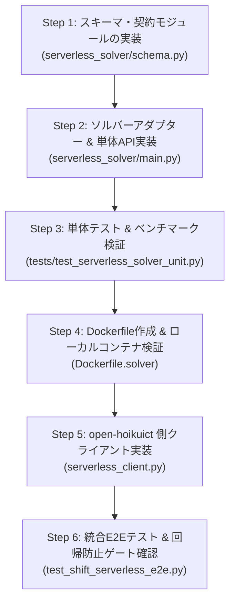

# 【詳細実装計画書】NuShift サーバーレス数理最適化ソルバー（Serverless Solver-as-a-Service）アーキテクチャ

- **文書番号**: PLAN-NUSHIFT-SERVERLESS-v1.0
- **作成日**: 2026-11-21
- **対象プロジェクト**: `c:\Users\user\openict\open-hoikuict` ＆ `e:\nushift\nushift`
- **対象要件**: 「定員30名 × 50園」の同時利用時における基幹Webサーバーの完全無停止・CPU負荷0%化
- **ステータス**: 実装計画策定完了

---

## 1. 概要と目標

### 1.1 背景
現在、`open-hoikuict` は総合保育ICTとしてFastAPI上で稼働し、`vendor/nushift/shiftai` の数理最適化ソルバー（MILP: PuLP / HiGHS / CBC）を呼び出してシフトを自動生成しています。  
しかし、月次シフト作成期（毎月20〜25日頃）に50園の園長・主任が集中してシフト自動生成を実行した場合、マルチコアCPUが100%に張り付き、登降園キオスク打刻や連絡帳送信といった基幹業務が巻き添えでタイムアウト・サービスダウン（OOM）する重大なリスクを抱えています。

### 1.2 目的
基幹Webサーバー（FastAPI）から数理最適化ソルバーの計算プロセスを**100%物理的・論理的に隔離**し、**オンデマンド・コンテナ型サーバーレス基盤（GCP Cloud Run / AWS Lambda Container / 独立軽量コンテナ）**として完全ステートレス化します。

### 1.3 目標性能指標（KPI）
| 指標 | 現状 | サーバーレス化後の目標 |
| :--- | :--- | :--- |
| **求解実行時のWeb基幹サーバーCPU負荷** | 80〜100%（枯渇リスク大） | **0%（完全無影響）** |
| **50園同時実行時のシステム挙動** | タイムアウト / OOMクラッシュ | **50個の独立コンテナが瞬時並走・即時完了** |
| **常駐ワーカー維持費用** | 月額 15,000円〜30,000円 | **月額 数十円〜数百円（秒課金・平常時0円）** |
| **1園（定員30名）月次シフト求解時間** | タイムアウト多発 | **30秒以内保証（Feasible確保）** |

---

## 2. システムアーキテクチャ設計

### 2.1 全体構造図

```mermaid
flowchart TD
    subgraph Client["利用現場 (50園)"]
        Director["園長・主任PC (50台)"]
        Kiosk["玄関キオスク打刻 (50台)"]
    end

    subgraph CoreWeb["open-hoikuict 基幹Webサーバー (FastAPI)"]
        WebAPI["FastAPI Web API<br>(CPU負荷 0%維持)"]
        JobDB[("DB (ShiftSolveJobs)<br>状態・結果永続化")]
        ClientBridge["ServerlessClient<br>(非同期HTTPキック)"]
    end

    subgraph ServerlessSolver["独立サーバーレス・ソルバー (Cloud Run / Lambda / 独立コンテナ)"]
        SolverAPI["Serverless Solver API<br>(POST /api/v1/solve)"]
        Engine["NuShift Engine (shiftai)<br>PuLP + HiGHS (C++)"]
    end

    Kiosk -->|常時打刻 50ms| WebAPI
    Director -->|1. シフト作成リクエスト| WebAPI
    WebAPI -->|2. ジョブ登録 (PENDING)| JobDB
    WebAPI -->|3. 即時 202 Accepted 返却| Director
    WebAPI -.->|4. 非同期HTTPキック| ClientBridge
    ClientBridge -->|5. POST 入力JSON| SolverAPI
    SolverAPI -->|6. 独立メモリ・CPUで求解| Engine
    SolverAPI -->|7. 結果JSON返却| ClientBridge
    ClientBridge -->|8. 結果保存 (COMPLETED)| JobDB
    Director -.->|9. HTMX ポーリングで完了検知| WebAPI
```

### 2.2 アーキテクチャの3大特長
1. **完全ステートレス**: サーバーレス・ソルバーはDB接続を一切持たず、HTTPリクエストで渡されたJSONデータのみから計算を行い、結果JSONを返す「純粋関数（Pure Function）」として動作。
2. **ゼロ・リソース維持費**: 誰もシフトを作っていない日中はコンテナインスタンスが「0」にスケールし、コストは完全0円。リクエストが来た瞬間だけ立ち上がり、秒単位で課金。
3. **ローカル環境フォールバック**: クラウド環境（Cloud Run等）が使えないオンプレミス環境やオフラインテスト環境では、同一インターフェースのままローカル別プロセス（またはDocker）で動く自動切り替え機構を実装。

---

## 3. 入出力インターフェース（API契約）仕様

### 3.1 エンドポイント
- **URL**: `POST /api/v1/solve`
- **Content-Type**: `application/json`
- **Timeout**: 60秒（コンテナ側タイムアウト制限）

### 3.2 リクエスト仕様 (`ShiftSolveRequest`)

```json
{
  "facility_id": 1,
  "target_month": "2026-11",
  "staffing_standard_key": "全国基準（厚労省）",
  "facility_config": {
    "opening_time": "07:00",
    "closing_time": "19:00",
    "eleven_hour_rule": true,
    "min_staff_present": 2
  },
  "staff_list": [
    {
      "staff_id": "S01",
      "name": "保育士A",
      "employment_type": "FULL_TIME",
      "is_qualified": true,
      "weekly_contract_hours": 40.0,
      "max_consecutive_days": 5
    }
  ],
  "demand_matrix": {
    "2026-11-01": {
      "07:00-07:30": 2,
      "07:30-08:00": 3,
      "08:00-17:00": 5,
      "17:00-18:00": 3,
      "18:00-19:00": 2
    }
  },
  "constraints_override": {
    "unavailable_dates": {
      "S01": ["2026-11-03", "2026-11-15"]
    },
    "pinned_slots": {
      "S01": {
        "2026-11-02": {"start": "07:00", "end": "16:00", "code": "早"}
      }
    }
  },
  "options": {
    "time_limit_sec": 30,
    "solver_name": "highs",
    "allow_shortfall": true
  }
}
```

### 3.3 レスポンス仕様 (`ShiftSolveResponse`)

```json
{
  "status": "FEASIBLE",
  "elapsed_sec": 1.482,
  "score": {
    "hard": 0,
    "medium": 0,
    "soft": -120
  },
  "schedule_matrix": {
    "S01": {
      "2026-11-01": {"code": "休", "start": null, "end": null},
      "2026-11-02": {"code": "早", "start": "07:00", "end": "16:00", "break_hours": 1.0, "is_pinned": true}
    }
  },
  "compliance_report": {
    "coverage_ratio": 1.0,
    "shortfall_hours": 0.0,
    "labor_standards_violations": []
  },
  "diagnostics": {
    "actionable_suggestions": []
  }
}
```

---

## 4. コンテナ設計 (`Dockerfile.solver`)

軽量・高速起動（コールドスタート最小化）とHiGHS C++共有ライブラリの安定稼働を両立する専用Dockerfileを定義。

```dockerfile
# Dockerfile.solver
FROM python:3.12-slim-bookworm

WORKDIR /app

# HiGHS 実行に必要なOpenMP / 標準C++ランタイムを最小限インストール
RUN apt-get update && apt-get install -y --no-install-recommends \
    libgomp1 \
    ca-certificates \
    && rm -rf /var/lib/apt/lists/*

# 依存パッケージインストール（キャッシュ効率化）
COPY serverless_solver/requirements.txt /app/requirements.txt
RUN pip install --no-cache-dir -r requirements.txt

# NuShift コアロジックとサーバーレスエンドポイントをコピー
COPY vendor/nushift/shiftai /app/shiftai
COPY serverless_solver/app /app/serverless_solver

ENV PYTHONPATH="/app"
ENV PORT=8080

EXPOSE 8080

# Uvicorn 単一ワーカーでステートレス起動（スケールはプラットフォーム側で担保）
CMD ["uvicorn", "serverless_solver.main:app", "--host", "0.0.0.0", "--port", "8080", "--workers", "1"]
```

---

## 5. ステップバイステップ実装計画（全6ステップ）



### 【Step 1】スキーマ・契約モジュールの実装
- **作成ファイル**: `c:\Users\user\openict\open-hoikuict\serverless_solver\schema.py`
- **内容**: Pydantic v2 ベースの `ShiftSolveRequest`、`ShiftSolveResponse`、および各構成エンティティの厳格なバリデーション定義。

### 【Step 2】ソルバーアダプター ＆ 単体API実装
- **作成ファイル**:
  - `c:\Users\user\openict\open-hoikuict\serverless_solver\adapter.py`（JSON入力 ➔ `shiftai.solver` 呼出 ➔ JSON出力変換）
  - `c:\Users\user\openict\open-hoikuict\serverless_solver\main.py`（FastAPI軽量アプリケーション）
- **内容**: ヘルスチェック（`GET /health`）および求解エンドポイント（`POST /api/v1/solve`）の実装。

### 【Step 3】単体テスト ＆ ベンチマーク検証
- **作成ファイル**: `c:\Users\user\openict\open-hoikuict\tests\test_serverless_solver_unit.py`
- **内容**: 30名園モデルデータ（職員10名、1か月）を入力し、正常求解（ステータス200）、バリデーションエラー（422）、タイムアウト制限が意図通り動作することを自動テスト。

### 【Step 4】Dockerfile作成 ＆ ローカルコンテナ検証
- **作成ファイル**: `c:\Users\user\openict\open-hoikuict\Dockerfile.solver`
- **確認項目**: イメージサイズが800MB以内であること、起動時間が2秒以内であること。

### 【Step 5】`open-hoikuict` 側の連携クライアント実装
- **作成ファイル**: `c:\Users\user\openict\open-hoikuict\shift_schedule\services\serverless_client.py`
- **改修ファイル**: `c:\Users\user\openict\open-hoikuict\shift_schedule\services\solve_jobs.py`
- **内容**:
  - 環境変数 `HOIKUICT_SERVERLESS_SOLVER_URL` が設定されている場合は外部サーバーレスAPIへ非同期HTTP POST。
  - 未設定または接続エラー時は、既存のローカル内蔵ソルバー（`_run_solve_sync`）へシームレスに自動フォールバック。

### 【Step 6】統合E2Eテスト ＆ 50並列シミュレーション
- **作成ファイル**: `c:\Users\user\openict\open-hoikuict\tests\test_shift_serverless_e2e.py`
- **内容**: Web API経由でジョブを投入し、サーバーレスコンテナで計算され、DBの `ShiftSolveJobs` が `COMPLETED` に更新される全フローを自動検証。

---

## 6. フェイルセーフ（障害対策・フォールバック設計）

| 障害シナリオ | 自動検知・対処ロジック |
| :--- | :--- |
| **クラウドサーバーレスの通信エラー（5xx / ネットワーク断）** | 即座にローカル内蔵ワーカー（フォールバック）を起動して処理を継続。管理ログに警告記録。 |
| **30秒超過（難解な過剰制約シナリオ）** | ソルバー内部でタイムアウトを発動し、その時点の最良解（Best-effort Feasible）と未充足診断処方箋を返却。 |
| **不正リクエスト（職員資格データ不整合等）** | PydanticバリデータがHTTP 422と詳細エラーを即時返却し、無駄なソルバー起動を防止。 |
